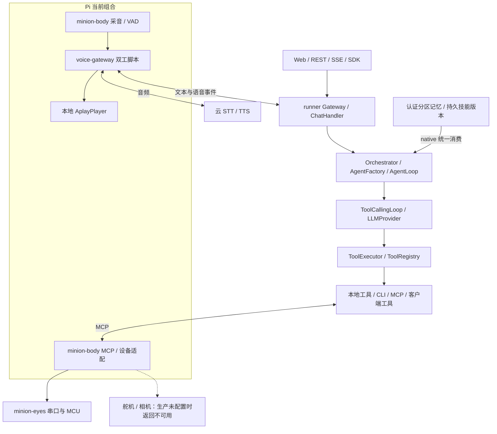
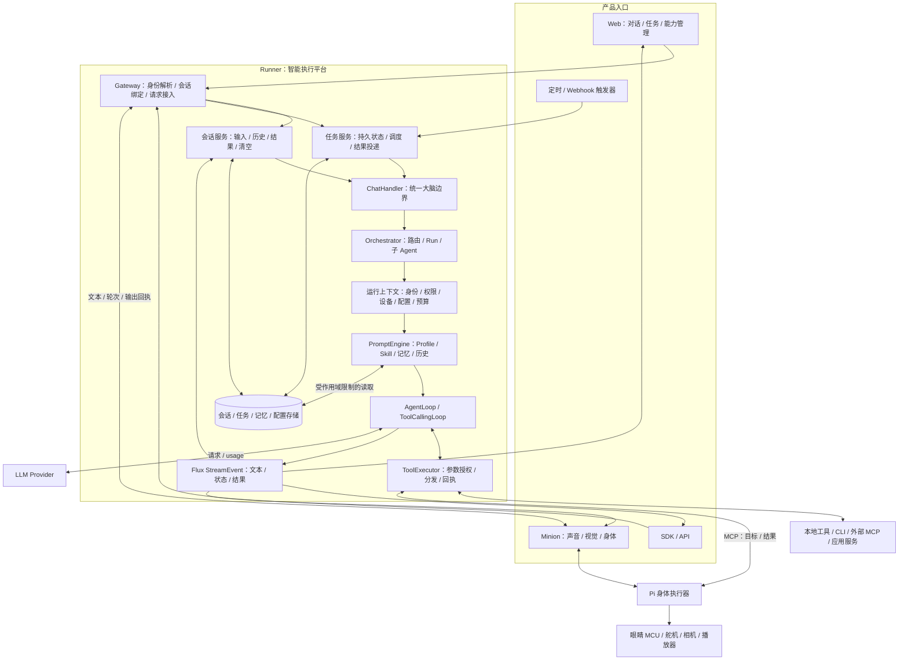
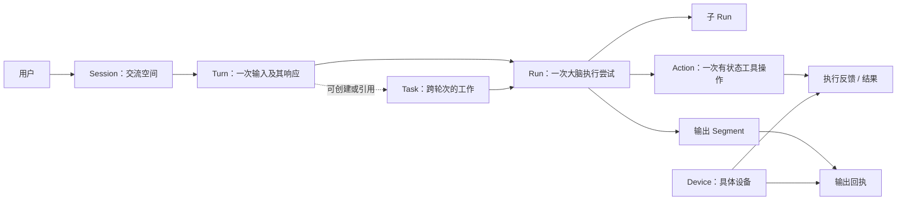
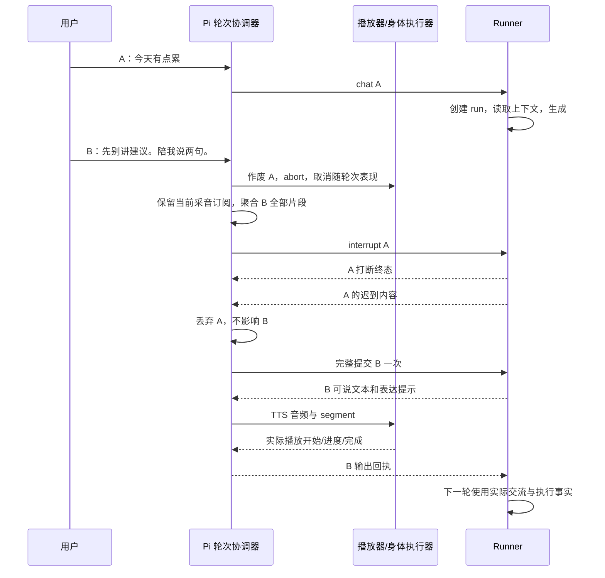
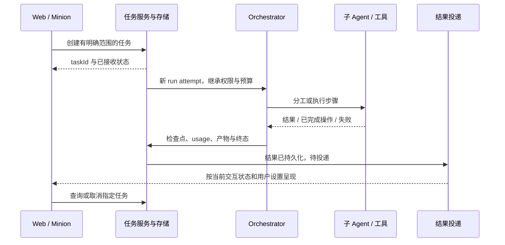
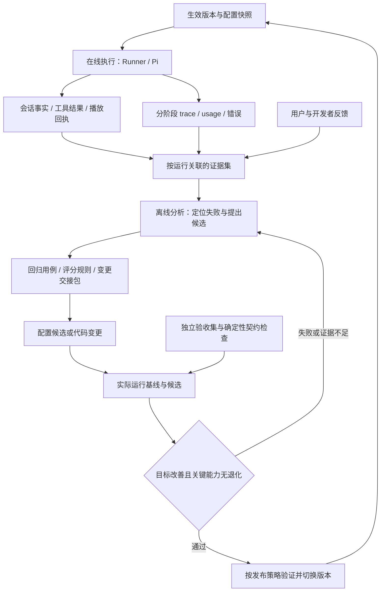

# Runner 与 Minion：端到端产品、架构与演进方案

初稿：2026-09-06；更新：2026-09-07。状态：**综合设计与实施跟踪**。本文确定全局方向、职责边界、迁移顺序和完成条件；目标能力不代表已经实现，各阶段的非平凡实现决策仍需单独形成 ADR。

现状依据 runner、voice-gateway、minion-body、minion-eyes 当前工作区，结合此前三轮 review、实体设计材料和业界一手资料。工作区包含未提交改动，不能与主分支或 Pi 已部署版本等同。历史分析保存在 [review 原文](../reviews/2026-09-06-minion-system-review.md)；本文重新判断其当前有效性。

阅读顺序：第 1—4 节明确产品、现状和架构全景；第 5 节完整展开 runner；第 6—8 节展开数据、现场交互与实体；第 9—11 节串起端到端流程、协议和验收；第 12—13 节确定迁移顺序与取舍。所有阶段和工作包集中在本文，不需要从历史 review 拼装实施路线。

继续工作时先读[当前实施进展与续接点](#124-2026-09-06-实施进展与续接点)。OpenAI 改进循环与 DSH 的对照在第 3.1—3.2 节，项目适配在第 5.12、11.4 节。

## 1. 总方向：让智能执行与现场交互组成一个完整产品

**Runner 演进为统一的智能执行平台，Minion 演进为这个平台具备声音、视觉和身体的桌面交互终端。两者通过统一的会话、任务、能力与结果模型协作。**

结合 OpenAI 的 Agent Improvement Loop 与 DeepSeek Harness（DSH），平台目标进一步明确为：**运行能力可组合，执行事实可重建，行为改进可验证。** 在线执行服务当前用户；离线改进依据真实轨迹、反馈和回归结果产生下一版候选，两者通过版本化配置与结果证据连接。新增取舍见 [ADR-017 提案](../decisions/017-versioned-harness-improvement-loop.md)。

Runner 自身需要能够承接 Web、SDK、API 和触发器请求，管理上下文，选择 Agent，调用模型和工具，跟踪任务，保存可靠结果。Minion 则让同一套智能能力进入物理现场：听见用户、自然回应、允许插话、表达状态、执行身体动作，并报告实际发生了什么。

因此，整体建设包含两条相互依赖的主线：一条把 runner 已有的编排、工具、记忆、技能和子 Agent 接成受统一约束的执行链；另一条把 Pi 上的收音、转写、播放、表情与设备调用接成具有唯一现场负责人和真实回执的交互链。两条链最终在同一份可信记录上汇合。

### 1.1 产品边界与使用形态

当前实体项目定位为个人自用，核心目标是“会对话、有表情、能动、音质好”。近期按一位主要用户、一台桌面机器人设计部署；runner 的通用能力保持独立，避免把设备接线和特定人格写进内核。[产品材料](/Users/hello/Documents/小黄人/files/README.md)、[实体决策](/Users/hello/Documents/小黄人/files/decisions.md)

| 使用形态 | 用户需要完成的事 | 产品应交付的结果 |
|---|---|---|
| Web 对话与操作 | 交流、查询、调用工具、继续之前的工作 | 连贯回答、过程状态、可核对的结果 |
| Minion 现场交互 | 自然说话、插话、看东西、请求表情或动作 | 听全、及时响应、身体表现一致、故障可理解 |
| 后台任务 | 较长分析、分步处理、按约定时间执行 | 可查询、可取消、可恢复的任务与结果 |
| 能力管理 | 配置模型、技能、工具、记忆和设备 | 配置实际生效，权限与可用性清楚 |
| 开发者集成 | 用 SDK/API 接入新的产品或工具 | 少量稳定入口、统一生命周期、可替换适配层 |

Web 管理端应围绕五类对象组织：会话、任务、能力、记忆、设备。每个页面回答一个实际问题：刚才发生了什么、工作进行到哪里、系统现在能做什么、它记住了什么、现场是否正常。调试详情作为进一步展开的信息，日常对话不要求用户理解 runId、MCP 或线程状态。

### 1.2 核心体验及架构含义

| 体验目标 | 可观察行为 | 必须具备的系统能力 |
|---|---|---|
| 交流连续 | 补充两句话不漏句，换入口或重启后能续上 | 完整输入、身份一致、持久会话 |
| 响应可控 | 可以改口、停播、取消指定工作 | 本地停播、定向取消、任务独立状态 |
| 执行可信 | 没有相机就明确说明，动作完成有依据 | 实时能力、参数授权、设备回执 |
| 行为一致 | 发布的技能生效，多个 Agent 遵守同一边界 | 版本快照、统一执行上下文、权限继承 |
| 可持续使用 | 任务不因页面关闭失踪，资源和费用有界 | 持久任务、预算、队列与资源生命周期 |

### 1.3 前台对话与后台任务的产品规则

一轮对话解决当下的交流。一个任务描述需要完成的工作，可以产生多个执行尝试，也可以跨越多轮对话。子 Agent 是完成工作的手段，本身不自动成为可恢复的后台任务。

例如“帮我整理这些资料，完成后告诉我”应创建任务，前台告知已接收和查询方式；工作完成后进入任务结果和通知队列。用户继续聊天不应抹掉它。用户说“先别说了”通常终止当前输出；用户说“刚才的整理也取消”才针对对应任务发出取消请求。无法可靠确定指代时，由对话澄清对象。

后台完成结果先持久化，再按用户设置决定呈现方式：网页通知、下次交互时提示，或已允许的设备播报。活动中的对话、安静时段和设备可用性影响投递。子 Agent 完成消息不能未经调度直接插入当前语音队列。

### 1.4 业务能力与通用平台的关系

现有 soul-user、soul-safety、soul-assessment 承载特定业务领域。它们继续通过用户服务、策略和工具接入 runner；通用内核管理会话与执行机制，业务模块提供领域规则。Minion 的人格属于 AgentProfile 与技能配置，身体能力属于工具和设备适配。这样，同一 runner 可以支持桌面伙伴及其他助手，而不需要复制执行内核。[业务模块](../modules/soul-modules.md)

## 2. 现状全景：有完整骨架，关键缺口集中在运行时接线

### 2.1 当前真实链路



仓库不是进程：voice-gateway 当前主要入口运行在 Pi，直接使用 minion-body 的采音/VAD，并本地播放。不能把它画成已经独立部署于云上的媒体网关。

### 2.2 能力与成熟度

| 领域 | 当前可保留的基础 | 当前缺口或证据边界 | 演进含义 |
|---|---|---|---|
| Runner 分层 | kernel 基座、web 装配、统一 Flux 事件、ChatHandler | 多种入口和管理路径仍存在历史分叉 | 保留分层，统一应用语义 |
| Agent 执行 | native 传递主体、设备、dispatcher、超时、权限和共享预算；执行固定 Provider、提示和工具快照 | 具体设备身份、OpenClaw workspace、完整持久谱系与 Profile 管理扩展仍待补齐 | 在已贯通作用域上继续接生产设备和任务事实 |
| 工具与子 Agent | 局部任务控制、父子权限交集、深度、取消和根预算；持久任务存储、runner 与投递队列已有验收 | 真实外部副作用核对、生产触发器和部署侧投递 consumer 仍待实施 | 从基础任务治理推进到真实交付 |
| 记忆 | 认证 native 与旧 `/gateway` 的历史、摘要、检索和工具写入共用主体分区 SQLite；重启与清空已有验收 | 旧未归属数据未自动迁移，播放事实与通用遗忘管理仍需补齐 | 保持单一来源，继续完善数据生命周期 |
| 技能 | 候选/评测/报告绑定、原子激活与回滚、重启恢复、实际提示消费已通过 ADR-024 验收 | Skill 发布范围不能涵盖全部运行代码与部署配置 | 扩展全框架候选与生产装配核对 |
| 持续改进 | 源码冻结、受控执行、报告/证据绑定、replay、同评测候选比较和主体反馈索引已实现 | 通用线上 trace 摄取、自动分析、完整生产发布与当前源码候选样本仍待完成 | 让受控证据与生产装配、反馈形成持续循环 |
| 长任务 | 文件任务存储、检查点、服务、有界 runner、主体隔离 API 和持久投递队列 | 重启可识别未知运行但不能自动核对外部副作用；生产触发和投递通道未装配 | 先保证不盲重做，再接真实调度与交付 |
| 大脑替换 | native 主线、OpenClaw 流式适配 | OpenClaw 的远端鉴权及 workspace 隔离未验证，有主体请求明确拒绝 | 对齐完整契约后再开放认证入口 |
| 语音轮次 | turnId、取消、旧帧过滤、完整 STT 聚合与输入交接 | 自动化与 Pi 声学验收尚有距离 | 将现有取消作为基线 |
| 语音表现 | 分句、TTS 事件、Realizer 组件 | 双工主入口未把 TTS 事件完整接入 Realizer | 用实际播放时间连接表现 |
| 身体与眼睛 | 生产缺失硬件返回 MCP 错误，串口成功报告提交且显示未确认；受控 SDK 往返通过 | 真实相机/舵机驱动、显示确认、唯一所有权与实机测量仍缺 | 从诚实回包继续推进真实设备与反馈 |

当前 [ADR-015](../decisions/015-voice-turn-cancellation.md) 记录 runner 轮次取消实现和自动化验证已经完成，包括真实 Python transport 对 Spring 的接缝，以及取消发生于订阅前缀时不遗留幽灵运行的验证。记录中的全量 reactor 构建覆盖 13 个模块。它不覆盖云 STT/TTS、声学插话或 Pi 真实播放；本文整理没有重新执行这些实机验证。

voice-gateway 当前 `capture_realtime()` 已持续向 STT 送音频，`collect_transcript` 已聚合多个 final 和最后 partial，插话输入继续使用同一采音订阅。因此此前“只收第一个 final”“录完再转写”的发现不能原样继续当作当前缺陷。[语音入口](/Users/hello/Documents/sourcecode/voice-gateway/scripts/gateway_voice_duplex.py)、[输入聚合](/Users/hello/Documents/sourcecode/voice-gateway/src/voice_gateway/capture.py)

### 2.3 Runner 问题的共同根因

第一类是**共享状态与执行状态混在一起**。`ScopedToolRegistry.register()` 为兼容仍委托 parent；ADR-018 已新增 `registerLocal()` 并迁移 native spawn 装配，消除了该路径把父会话绑定写入全局表的问题。`ToolExecutionContext` 现已传递主体、记忆视图、取消以及模型/配置作用域；DeviceContext 仍只描述设备类型和版本，具体设备 ID 与持久运行身份仍需补齐。不能把这个类型的存在等同于完整上下文已实现。[ScopedToolRegistry](../../agent-kernel/src/main/java/com/lightweightai/kernel/agent/ScopedToolRegistry.java)、[ToolExecutionContext](../../agent-kernel/src/main/java/com/lightweightai/kernel/core/ToolExecutionContext.java)、[DeviceContext](../../agent-kernel/src/main/java/com/lightweightai/kernel/agent/DeviceContext.java)

第二类是**管理配置需要通过实际消费验证**。ADR-023/024 已把持久 Skill 版本与统一 PromptSource 接入 AgentLoop，并记录执行装配清单；ADR-026 将 Provider usage、共享预算与循环压缩接入真实请求边界；ADR-031 持久化模型预设元数据。Profile 管理扩展和部署级配置仍需继续。这些问题应通过检查模型请求与执行结果解决，不能用“页面显示 active”或“builder 不为空”代替。[AgentLoop](../../agent-kernel/src/main/java/com/lightweightai/kernel/agent/AgentLoop.java)、[SkillPublishService](../../agent-web/src/main/java/com/lightweightai/web/skillcreator/SkillPublishService.java)、[ToolCallingLoop](../../agent-kernel/src/main/java/com/lightweightai/kernel/core/ToolCallingLoop.java)

第三类是**事实需要一致的读写方**。ADR-025 为新认证 native 请求接入同一 SQLite 分区与 NativeSessionManager，历史、检索、工具写入和清空已有往返验收。旧 GatewayService 与未归属文件保留为兼容路径；不能把它们的记录当作新用户或外部 backend 的真实上下文。[FileMemoryAdapter](../../agent-web/src/main/java/com/lightweightai/web/config/FileMemoryAdapter.java)、[GatewayService](../../agent-web/src/main/java/com/lightweightai/web/gateway/GatewayService.java)

这三类问题决定了优先级：先把运行身份、配置、权限和记录接通，再扩大 Agent 数量、主动行为或设备功能。

## 3. 业界架构给出的依据与本项目取舍

这里借鉴经过实践的职责划分，具体路线仍基于现有 Java/Python/C++ 工程。

| 参考 | 可借鉴的原则 | 在本项目中的落点 |
|---|---|---|
| Anthropic 的 workflow/agent 区分 | 固定流程与模型自主决策采用不同控制方式 | 鉴权、轮次、任务状态和设备停止由程序确定；开放问题由 Agent Loop 处理 |
| LangGraph persistence | 执行线程状态与跨线程长期信息分别持久化 | 会话/任务恢复记录与长期偏好、知识分开；内存 run 不能冒充持久任务 |
| LiveKit turn handling | 发言边界、打断和播放后的上下文各有语义 | 生成结束与播完分离，打断记录关联输出进度 |
| Pipecat frames | 高优先级系统信号与普通内容具有不同队列语义 | 取消、关闭、故障不堵在音频积压之后 |
| ROS 2 Actions / Lifecycle | 接收目标、执行反馈、结果，以及设备生命周期 | MCP 工具提交动作后，身体执行器给真实状态与完成依据 |
| Home Assistant Assist | 唤醒、STT、意图、TTS 分阶段可观察 | Pi 交互管线有明确阶段和设备/会话关联 |

以上分别依据 [Anthropic 架构文章](https://www.anthropic.com/engineering/building-effective-agents)、[LangGraph persistence](https://docs.langchain.com/oss/python/langgraph/persistence)、[LiveKit turns](https://docs.livekit.io/agents/logic/turns/)、[Pipecat frames](https://docs.pipecat.ai/api-reference/server/frames/overview)、[ROS 2 Actions](https://design.ros2.org/articles/actions.html)、[ROS 2 lifecycle](https://design.ros2.org/articles/node_lifecycle.html)、[Assist pipelines](https://developers.home-assistant.io/docs/voice/pipelines/)。Anthropic 文章发表于 2024 年，此处只采用 workflow/agent 的结构区分；不把其中工具生态当作当前选型结论。

由此形成四项取舍：保留 native Agent Loop 与 Tool 扩展基础；保持 STT→LLM→TTS 可分别替换；Pi 掌握现场即时控制；MCU 持续渲染和执行低层行为。近期不以引入大型编排框架、消息中间件或 ROS 2 作为前置条件。是否引入，应由同场景的可靠性、维护成本和能力需求决定。

### 3.1 OpenAI 改进循环与 DSH 分别补足什么

OpenAI 的示例把执行轨迹、人工/模型反馈、生成的 Promptfoo 评测、HALO 诊断与 Codex 实施交接连在一起。其 harness 包含提示、工具、路由、输出要求与验证规则。值得注意的证据边界是：示例评测器给已有 trace 输出打分；验证下一版必须实际运行候选。示例中的五项通过只说明该套评测满足，后续仍建议加强产物验证。[OpenAI Cookbook 原文](https://developers.openai.com/cookbook/examples/agents_sdk/agent_improvement_loop)

DSH 通过 Cordis 组合服务、事件与具有释放机制的注册；模型、工具、会话和驱动循环都可替换。部署 profile 由有序 bundle/patch 组成；当前 Web profile 支持实时重载，若干一次性或 SDK 入口在启动时固定装配。[DSH 官方架构，核对提交 `d347e703908d`](https://github.com/deepseek-ai/deepseek-harness/blob/d347e703908d0406b7a7ef80e3a0e594d86b2215/docs/architecture.md)

以下是针对 runner 的设计推导，框架中的同名概念不直接视为本项目已有 API。

| 维度 | 外部参考带来的问题 | Runner 的选择 |
|---|---|---|
| 运行装配 | 哪些能力能独立替换，配置最终组合成什么 | 明确模型、工具、会话、策略、输出适配的接口/实现/消费者；记录生效配置 |
| 运行作用域 | 能力属于谁，结束后谁释放注册和资源 | 共享目录叠加 run 局部绑定；取消、正常结束和失败走可核对的清理边界 |
| 会话事实 | 模型请求、历史页、追踪能否解释同一次执行 | 由统一记录与配置快照派生各视图，区分生成、播放与设备执行事实 |
| 质量改进 | 用户指出一次失败后，如何防止再次发生 | 反馈关联 trace，转成可复现用例，再验证候选对目标与旧能力的影响 |
| 实施交接 | 评测发现能否指向具体可修改边界 | 交接包包含失败、证据、建议落点、候选范围、验收及回退条件 |
| 发布 | 被测版本是否就是实际生效的版本 | 以内容摘要绑定配置、测试、发布和运行，消费失败不标记生效 |

### 3.2 借鉴机制时保留本项目的约束

DSH 的 scoped registration 同时表达可见范围和生命周期归属，其释放边界可供并发调用共同等待；这为 runner 的局部工具、observer 与资源清理提供参照。[DSH scope](https://github.com/deepseek-ai/deepseek-harness/blob/d347e703908d0406b7a7ef80e3a0e594d86b2215/docs/subsystems/scope.md)

工具执行方面，DSH 将可改写的处理链、只能拒绝或弃权的约束检查、最终结果通知分开。runner 可据此明确检查顺序：参数形成后授权，硬性拒绝不被后续扩展覆盖，最终收到的结果再进入历史和评测。[DSH tool pipeline](https://github.com/deepseek-ai/deepseek-harness/blob/d347e703908d0406b7a7ef80e3a0e594d86b2215/docs/tool-execution-pipeline.md)

DSH 从类型化 session 事件派生模型消息，并保留请求配置和提示/工具快照。runner 的迁移目标是可追溯地重建一次请求，采用现有存储先逐步补齐事件与投影；诊断 trace、持久业务事实、实时增量分别维护。追加日志仍要服从本项目的清空、遗忘与保留范围，存储重建也不意味着重新执行外部工具。[DSH session](https://github.com/deepseek-ai/deepseek-harness/blob/d347e703908d0406b7a7ef80e3a0e594d86b2215/docs/subsystems/session.md)

本项目保持 `agent-kernel` 基座、`agent-web` 唯一 Spring 装配与增量公共 API。DSH 的 plugin 指通用组件组合机制；runner 新扩展继续使用 Tool、现有 SPI 和显式装配，legacy Plugin 包维持兼容用途。DSH 的部署 profile 与 runner 的 AgentProfile 人格/权限配置分属两个层次；DSH 的 turn/step 也不能直接映射为 Minion 的 turnId/runId。新增控制生命周期继续使用 `StreamEvent.EventType` 与 factory。

近期先保证新 run 使用新快照、旧 run 保持原配置，权限撤销和设备失联则即时生效。插件卸载释放注册与连接，已经发生的工具副作用和身体动作仍按结果/停止协议处理。DSH 当前标注 developer preview；直接接入它作为外部大脑时，另行验证 ChatHandler、取消、历史、设备工具和版本兼容。[DSH 项目状态](https://github.com/deepseek-ai/deepseek-harness/blob/d347e703908d0406b7a7ef80e3a0e594d86b2215/README.md)

## 4. 目标架构全景

### 4.1 从产品入口到结果的完整结构



图中的会话服务、任务服务、运行上下文是目标职责，不要求每一格新建一个独立模块。共同上下文贯穿后续调用；预算、授权和可观测性也不是只在入口检查一次。

这张图描述在线运行。第 11.4 节的离线改进工作流读取版本化执行证据，形成候选并通过发布服务影响后续运行；在线对话不等待反馈分析或优化器完成。

### 4.2 三个运行位置

| 位置 | 负责 | 状态归属 | 断联时的行为 |
|---|---|---|---|
| Runner 部署 | 理解、规划、工具治理、任务与持久记录 | 会话、run、task、权限、技能版本、长期信息 | 标记中断/未知；后台任务按恢复策略处理 |
| Pi 统一入口 | 输入提交、插话、STT/TTS、本地表现和设备执行 | 当前现场轮次、音频缓存、播放游标、设备占用 | 可立即停播和停止可取消动作，进入可理解状态 |
| MCU / 驱动器 | 连续渲染、受限动作和反馈 | 动画时钟、驱动状态、底层保护 | 按已定义的断联策略自治或停止 |

Pi 近期优先一个受监督运行入口，内部复用 voice-gateway 和 minion-body 模块。所有麦克风、播放器、串口、相机和舵机都指定一个逻辑所有者；MCP 服务与 Realizer 经这个所有者访问设备。驱动需要崩溃隔离时再用独立进程和本地 IPC，所有权仍保持唯一。

这一部署与所有权方向也记录在 [ADR-016 提案](../decisions/016-local-interaction-runtime.md)，其状态仍为 Proposed；本方案将其放入包含 runner 产品与任务能力的全局路线。

### 4.3 Runner 模块落点与依赖

| 模块 | 保留/补齐的职责 |
|---|---|
| agent-kernel | Gateway/ChatHandler、运行模型、执行上下文契约、Agent Loop、Tool/Policy、事件、存储端口与模型适配 |
| agent-tools | 具体工具；固定业务流程可封装为工具，不能把业务实现塞入内核 |
| agent-mcp | MCP 协议、传输、工具映射、相关错误与取消传播 |
| kernel-memory | 会话/记忆存储适配与检索；是否增加独立任务存储模块在落实时决策 |
| agent-openclaw | 外部大脑适配，对齐会话、取消、工具结果与管理契约 |
| agent-sdk | 稳定、简洁的开发者入口，复用相同执行语义 |
| soul-* | 领域用户、策略和工具能力 |
| agent-web | 唯一 Spring 装配点，HTTP/WebSocket、管理 API、配置与实例生命周期 |

kernel 不依赖这些实现模块。新存储端口放在 kernel，由适配模块实现，在 web 装配。现有 `Tool`、`ToolSourceProvider`、公开 MCP API 及已弃用兼容成员保留；新能力通过新增类型、默认方法或重载加入。[现有架构约束](../architecture.md)、[工程规则](../../CLAUDE.md)

### 4.4 四类信息通路

语义通路传输入、文本、工具目标和结果；媒体通路传音频及其格式和偏移；控制通路传取消、停止、故障与能力变化；记录通路传播放回执、执行事实和诊断数据。原始音频主要在 Pi 与语音服务间流动，JVM 继续消费语义。它们可以共用现有连接和进程内事件，无需四套基础设施。

## 5. Runner 详细设计：把一次请求变成受控、可追踪的执行

### 5.1 请求接入：先明确谁在什么会话、设备和任务中发起请求

Gateway 将 WebSocket、REST、SSE、SDK 的载荷转换为统一请求。接入层完成已验证身份解析、会话归属检查、目标设备解析和请求去重，再进入 ChatHandler。客户端传来的 userId、deviceId 不能直接充当授权依据；嵌入式 SDK 的可信调用方则通过明确的本地身份适配接入。

连接仅代表传输通道，不代表长期会话。断开连接、停止一次输出、取消一个 run 和删除会话需要各自的操作语义。已有 `agent:<agentId>:main:<sessionId>` 等内部命名空间继续有效，外部会话通过映射解析，避免直接改字符串造成历史分裂。

同一前台会话近期只允许一个活动输出轮次。新输入按入口选择排队、拒绝或定向替换，规则显式化；其他会话和后台任务可以并发。保留当前延迟到订阅才分配运行的行为：订阅前取消不得写入用户历史或遗留 RUNNING 状态。

### 5.2 运行上下文：一份来源，贯穿所有执行环节

目标为每次运行冻结一份配置与身份视图，并关联可变的取消、预算和状态句柄。表中的名称描述信息职责，最终类型复用现有上下文并做增量扩展，不要求建立多份互相拷贝的大对象。

| 信息组 | 内容 | 消费方 |
|---|---|---|
| 身份 | principal/user、session、agent、turn、run、可选 task、parentRun | 记忆、策略、追踪、子 Agent |
| 设备 | 具体 deviceId、已有 DeviceContext 类型/版本、能力版本与有效期、dispatcher | 工具选择与执行分发 |
| 配置 | Profile 版本、模型参数、Skill 版本、提示构建版本 | Factory、PromptEngine、Provider |
| 约束 | 权限范围、截止时间、迭代/并发限制、预算句柄 | Orchestrator、Loop、Executor、子 Agent |
| 控制 | CancellationToken、资源作用域、trace 上下文 | 全链取消、资源清理、日志关联 |

主链为 `Gateway → Orchestrator → AgentFactory → AgentLoop → ToolCallingLoop → ToolExecutor → adapter`。已有 `ToolExecutionContext` 是工具侧承载点，补齐调用入口与继承关系；异步和 Reactor 路径通过参数或明确的 Reactor Context 传播，不能依赖线程局部变量碰巧仍在同一线程。

配置快照保证运行可解释，执行时重新检查权限与设备在线状态保证变化及时生效。新技能版本通常从下一次 run 生效；权限撤销、设备失联等不能等到下一次 run 才被发现。

### 5.3 工具体系：目录、绑定、授权、执行各司其职

全局 ToolRegistry 保存可共享、无会话绑定的工具目录。每个 run 在其上叠加局部工具视图，绑定 spawn/wait、客户端 dispatcher 等上下文。局部名称冲突采用确定规则，并对保留名称拒绝意外覆盖。构建模型工具定义必须发生在局部绑定完成之后，否则工具对象存在、模型却看不到。

现有 `ScopedToolRegistry.register()` 的转发行为已经对外可见，不应直接偷偷改义。ADR-018 已增加 `registerLocal()`，由 native Factory 在构建 AgentLoop 前装入 spawn 工具；旧注册语义与兼容调用保留。当前局部同名覆盖仅作用于本 scope，保留名称的显式保留策略仍待定义。`get`、`getEnabled`、`isEnabled` 和 definitions 必须消费同一个视图。[AgentFactory](../../agent-kernel/src/main/java/com/lightweightai/kernel/orchestrator/AgentFactory.java)

工具目录过滤只回答“模型可以看见哪些工具”。真正调用前，ToolExecutor 用实际参数、已验证身份、当前设备和权限再判断“这次操作是否允许”。ADR-018 已保留目录阶段的空参数检查，并增加携带实际参数、所选工具实现与 ToolExecutionContext 的执行校验；ADR-019 进一步接通父子权限交集与设备上下文；ADR-025 已加入服务器主体和实际记忆视图，根预算仍待 ADR-026 实施。

执行结果区分参数错误、权限拒绝、能力不可用、远端失败、超时和结果不确定。模型可以依据可修正错误继续，无法修正的失败有明确终态。并行工具仅在资源互不冲突时执行；同一身体执行器再做最终资源仲裁。平台策略约束允许的动作，身体控制器约束机械上能安全执行的范围。

### 5.4 提示与技能：发布状态必须对应实际行为

统一提示构建顺序建议为：平台约束 → AgentProfile 与人格 → 本 run 选中的技能版本 → 当前设备/任务事实 → 有来源的相关记忆 → 会话历史与当前输入。工具定义与文本提示从同一权限及配置快照生成。配置覆盖采用明确优先级，用户请求中的模型偏好只在允许范围内覆盖 Profile 默认值。

SkillPublishService 激活持久版本，运行侧从统一版本目录取快照；不靠向某个 PromptEngine 实例注册就宣布整个系统已生效。ADR-024 已在保留创建、测试、发布流程的基础上，验证激活版本进入下一次真实 Provider 请求，并拒绝用修改前的测试结果发布新内容。运行日志保存版本 ID 与提示构建标识，敏感全文仅在受控调试时留存。

技能是可复用行为说明和允许使用的能力组合。记忆是关于用户或世界的信息。一次成功轨迹可以产生候选技能，但需要独立测试与发布；不能仅凭生成成功自动覆盖活跃版本。`SkillGeneratorObserver` 的可变轨迹必须按 run 隔离，避免并发混合。[技能观察器](../../agent-kernel/src/main/java/com/lightweightai/kernel/learn/SkillGeneratorObserver.java)

持续改进还可能修改工具契约、流程、模型配置、上下文投影和验证器。候选须声明变更类型，分别走配置发布或代码变更流程。Skill 发布只负责它覆盖的配置部分，不承担任意代码和设备控制的在线自修改；评测闭环见第 11.4 节。

### 5.5 模型循环：统一预算、压缩、停止和工具反馈

保留 `AgentLoop → ToolCallingLoop` 主结构，让同步、reactive、SDK 和 Web 入口共享核心约束。每次模型调用前检查取消、截止时间、剩余预算与上下文长度；每次响应按实际 usage 记账，再决定下一轮。usage 缺失时记录估计值及其来源，不能按零计费。

预算至少包括模型上下文窗口、累计 token/费用、迭代次数、墙钟期限和并发工具数。父 run 为子 run 分配预算，汇总实际使用；并发请求需要预留或限制额度，事后检查无法严格保证总上限。现有 CostTracker 可作为起点，实际费用换算采用带版本的配置，不把 token 数直接当成货币。

ContextCompactor 在初次请求和工具结果增长后都能工作，保留 tool call/result 对、未完成任务约束、当前输入及关键结果。压缩摘要保留来源与覆盖范围；大图片和工具大结果采用大小限制、外部引用或选择性保留。不能删掉调用只留下返回值，使下一次模型请求结构失效。

Provider 保留文本、工具调用、usage、stop reason 和多模态结果的语义。瞬时网络错误的自动重试以是否已产生输出/副作用为依据；工具副作用已发生时，重跑整个 loop 可能重复执行，需要先查询执行记录。

### 5.6 子 Agent：受父任务约束的执行树

SubagentRuntime 承担 spawn、等待结果、列举与级联停止。ADR-019 已实现子任务消息分支、父子权限交集、上下文继承和逐代深度限制；叶子 Profile 可以工作但不能再 spawn，宽松 Profile 不能恢复父任务耗尽的层数。局部 wait/list/stop 只管理结构化作用域（根会话与独立子任务 ID 路径）匹配的直接子任务，stop 沿实际父子关系级联，不从客户端 session 文本推导子任务身份。祖先策略保留自己的 Profile 语义；当前 run 的终态检查不向后代继承。服务器主体与存储分区已有 ADR-025 验收；共享根预算与持久任务状态仍是后续目标。

父 Agent 收到结构化结果：成功/失败/取消、产物引用、已完成操作与未解决问题。它据此综合结果，不能只消费一句“完成”。失败传播采用任务约定：允许部分结果的任务汇总缺口，要求全部成功的任务进入失败或等待处理。

ADR-020 已接通在途前台执行的显式打断、隐式接续、订阅取消和失败：该次执行的取消信号传入所有层级的子任务，停止活跃后代并拒绝迟到工具调用。同一会话的新轮使用独立信号，旧清理不能误停新工作。正常完成仍保留异步子任务，已结束前台的语音停播不会追溯取消它们；显式 stop 可沿实际父子关系停止后代。未来需要脱离前台、跨重启继续的工作由持久 Task 服务拥有，当前内存后台任务不提供这一保证。

### 5.7 持久任务：在现有编排之上补全运行之外的生命周期

任务服务保存目标、发起者、约束、输入/产物引用、执行尝试、状态、截止时间和投递策略，再启动 Orchestrator。TriggerSource 把定时或 Webhook 转成同类任务请求，带触发 ID 和去重键。固定步骤使用确定流程，需要探索的步骤调用 Agent Loop；二者复用工具授权与结果记录。

建议状态为 `queued → running → succeeded`，分支为 `waiting_user / failed / cancelled / recovery_required`。`cancel_requested` 是中间事实，不代表已停止。一次 Task 可有多个 Run attempt，每次尝试使用新的 runId，保留因果关系。

初期只承诺在明确检查点恢复：输入已持久化、某一步工具结果已保存、待执行下一步。外部副作用使用幂等键和执行记录；提交后崩溃、结果未落盘的步骤先核对远端，无法核对则进入 recovery_required。持久记录与外部调用之间没有天然原子事务，不能承诺任意代码位置无损续跑。

单实例可用现有存储技术补齐表和本地调度；扩成多 worker 后再加入租约、并发领取与失效接管。后台任务的持久能力建好之前，产品应明确其运行范围，不把内存 SubagentRun 展示成跨重启保证。

### 5.8 会话、长期记忆与知识

会话服务统一接收输入与最终结果，提供查询、摘要、清空和重启恢复。native 路径的 MemoryProvider、Gateway SessionManager 和管理端都消费同一身份映射与数据来源。长期偏好和知识检索通过作用域明确的端口进入提示，不能让裸 `search(query)` 意外跨用户检索。

记忆分为交流事件、明确偏好/事实、可检索资料三类。后两者有来源、更新时间、适用主体和失效方式。用户修正应影响真正供下一次模型读取的信息；删除会话、遗忘某偏好和取消某任务是不同操作，管理端给出相应范围。

FileMemoryManager 与 SQLite 组件继续复用，但要明确哪份记录是权威来源、哪些是可重建索引。先以单实例持久存储完成一致性；出现并发、多实例或运维需求时再迁移数据库，避免先换存储却保留两套历史语义。

### 5.9 输出事件、领域策略与客户端投递

所有 reactive 输出继续使用 `Flux<StreamEvent>`。新 run/task/输出生命周期需要显式 EventType 和 factory；序列化器和下游消费者同时适配，不把协议控制塞进 TRACE 文本。区分局部工具失败、整次运行失败、用户取消和正常完成。

Web 可显示工具进度、产物卡片；Pi 接收适于播出的文本与表达提示。领域策略拦截必须产生所有入口都理解的终态和适当提示，不能只返回网页能识别的业务事件，让语音端一直等待。通知与主动播报经过统一投递策略，后台事件不能直接抢占播放器。

### 5.10 Native 与 OpenClaw 的边界

保留 ChatHandler 作为大脑适配点。native 完整消费本节运行约束；外部 backend 通过适配器证明会话归属、历史查询/清空、取消、工具政策和错误语义。无法提供某能力时显式声明，不能仅凭能流式聊天就宣告等价。

同一会话只绑定一个 backend。外部 backend 若负责自己的模型上下文，runner 保留面向产品的交流/任务结果账本，并通过显式导入或摘要迁移衔接历史；这两份记录用途不同，不能都作为同一聊天上下文的写入权威。跨 backend 切换先检查历史与进行中任务，再执行受控迁移。[ADR-014](../decisions/014-brain-swappable-chathandler-openclaw.md)、[OpenClaw 模块状态](../modules/agent-openclaw.md)

### 5.11 SDK 与管理端：同一能力的不同入口

SDK 保持简单，增加能力时通过可选配置、事件和结果类型暴露；不要求调用方装配 Spring。REST、WebSocket 与 SDK 的历史、取消、工具可见性和错误语义通过共同场景验证。旧 SoulComfortChatService 路径逐步成为兼容适配，迁移期间核对真实读写和默认装配，避免只切换页面入口。

管理端显示“已保存配置”“已激活版本”“本次运行使用版本”三个不同事实；任务详情显示尝试记录和已完成副作用；设备页显示实际能力、最后更新时间和降级原因。管理产品由运行时事实驱动。

### 5.12 装配清单与运行作用域

借鉴 DSH 的组合机制，先为已有装配建立可检查的清单：部署选择的 ChatHandler、Provider、存储、ToolSourceProvider、策略和后处理器；每项的配置来源、版本、依赖与关闭责任。清单中只包含配置引用及非敏感生效参数，密钥保留在运行环境。现有 Spring 配置与 Factory 消费它所描述的同一选择，无需先引入通用热插拔容器。

| 作用域 | 持有内容 | 释放边界 |
|---|---|---|
| 应用 | 共享 Provider 连接池、工具定义、存储适配 | 应用退出或完成受控替换 |
| 会话 | backend 绑定、会话读写句柄 | 关闭会话句柄；持久记录按数据策略保留 |
| run / 子 run | 局部工具、observer、取消与预算句柄、订阅 | 完成/失败/取消均结束本方工作并释放局部注册 |
| Pi 设备实例 | 麦克风、播放器、串口与动作仲裁 | 设备运行时关闭；单轮结束只清本轮输出 |

创建运行前核对缺失依赖与保留工具名冲突；运行期间对设备和权限动态检查。释放必须幂等且可等待，旧回调只能清理旧实例。确定性场景覆盖“登记后失败”“取消与自然结束竞争”“A 清理时 B 已接入”，断言实际资源和后续消费者状态。需要动态重载时再明确哪些依赖能在无活动工作时替换，以及不满足条件时如何拒绝切换。

## 6. 全局数据与状态模型：每件事有身份，每个事实有写入方

### 6.1 对象之间的关系



| 对象 | 标识与内容 | 生命周期/权威写入方 |
|---|---|---|
| Session | sessionId、用户、backend、参与设备 | 跨连接；runner 会话服务 |
| Turn | turnId、已提交输入、取消目标、相关输出 | 一次交流；输入提交后由会话服务持久记录，Pi 管本地采集状态 |
| Run | runId、parentRunId、配置版本、usage、终态 | 一次执行尝试；所选 backend 运行时 |
| Task | taskId、目标、尝试、检查点、产物、投递策略 | 可跨会话轮次/重启；任务服务 |
| Action | actionId、toolCallId、目标、幂等键、效果状态 | 从接收至最终反馈；执行端产生事实，runner 保存 |
| Segment | segmentId、turn/run、文本、音频关联、表达意图 | 一段输出；生成端创建，播放端另报交付状态 |
| PlaybackReceipt | device、segment、进度、终态、序号 | Pi 播放器产生；runner 幂等入库 |
| Capability | deviceId、类型、能力版本、状态、更新时间 | 身体运行时报告；runner 缓存并执行时复核 |
| SkillVersion | 技能、版本、测试、激活状态 | 发布服务；每个 run 固定选用版本 |
| Trace | trace/span、业务对象关联 | 观测系统；不替代任何业务主键 |

turnId、runId 和 taskId 各有用途，不能合成一个 ID。跨连接恢复仍使用原 session；重试任务产生新 run；同一动作重试是否沿用幂等键取决于是否在重试同一个业务操作。

### 6.2 状态分开，终态聚合

| 状态对象 | 正常路径 | 其他结果 | 意义 |
|---|---|---|---|
| 输入 | collecting → committed → submitted | abandoned / failed | 用户发言何时成为可执行输入 |
| 生成 | running → completed | cancelled / failed | 大脑是否还会继续生成 |
| 播放 | buffering → playing → completed | cancelled / failed / unknown | 输出端实际播到哪里 |
| 动作 | accepted → running → completed | rejected / failed / cancelled / unknown | 操作是否真正完成 |
| 任务 | queued → running → succeeded | waiting_user / failed / cancelled / recovery_required | 工作是否达到目标 |

这些是目标语义；实际枚举按具体实现和 ADR 确定。`cancel_requested`、`sent` 可以作为中间事实记录，不能显示成 completed。各对象的终态写入采用身份与版本检查，重复回执不重复追加，旧回调不能覆盖新 run 或新 turn。

一轮语音交流只有在生成已结束、输出已结束或明确放弃、相关前台操作已形成结果后，才具备完整的交流结论。被转交后台的 task 保持独立，不让前台等待其全部结束。

### 6.3 取消分成四种具体动作

1. **停止输出**：立即作废指定 turn 的待播内容，终止播放/TTS 和随语音待执行表现。
2. **取消运行**：向指定 run 传播 token、释放订阅与任务资源，并结束相应事件流。
3. **取消任务**：停止调度未来步骤，通知正在执行的 run/action，等待或核对取消结果。
4. **停止身体动作**：由本地控制器执行已验证的停止措施并反馈状态。

这四者可以由一次用户意图协调触发，但没有“取消等于回滚”的保证。已创建的提醒、已发送的外部请求或已完成的动作仍需要保留事实。MCP 的请求取消也不保证已完成或不可取消操作被撤销。[MCP cancellation，固定参考版本 2025-06-18](https://modelcontextprotocol.io/specification/2025-06-18/basic/utilities/cancellation)

### 6.4 记忆投影以可靠事实为依据

保存用户提交内容、系统生成内容、工具执行事实和输出回执。下一轮提示从这些记录构建适合交流的视图：已播放内容、部分播出标记、未播出但相关的执行结果。模型生成了完整回答并不代表设备已经播完；设备播完也不能证明用户听懂了。

没有词级对齐时，打断中的语句记为部分播出，不按音频比例猜字符位置。多入口时分别记录网页交付和音频交付，不能因为 Pi 没播就删除已经在网页显示的文本。诊断日志、检索索引和模型上下文是不同投影，共同引用权威事实。

## 7. Minion 软件详细设计：本地协调输入、输出和身体

### 7.1 统一入口与设备所有权

voice-gateway 负责交互轮次和语音服务适配，minion-body 负责身体执行与设备生命周期。二者在 Pi 装配为一套运行时：一个麦克风采集源、一个播放器、一个眼睛串口管理者、一套舵机与相机实例。MCP 和 Realizer 调用同一个身体执行入口。

当前 AplayPlayer 可先保留在原模块，通过注入共享实例完成收敛；无需先搬文件。核心验收是同时存在 MCP 请求和语音表现时，仍然只有一个资源所有者、一个仲裁结果和一致设备状态。[播放器](/Users/hello/Documents/sourcecode/voice-gateway/src/voice_gateway/player.py)、[身体设备](/Users/hello/Documents/sourcecode/minion-body/src/minion_body/device.py)

启动依次检查配置、设备枚举、采音/播放格式、语音服务与 runner 连接，再报告可用能力。组件具有 configured、ready、active、degraded、failed 等明确状态。关闭先拒绝新工作，再取消交互、停止设备任务、释放队列与文件句柄；每一步有期限，不能无限等待 SDK 结束。

### 7.2 输入：采音、唤醒、转写和发言边界

单一 FrameFanout 将音频送给 VAD、转写及必要的本地判断，避免多个采集者竞争设备。STT sentence-final 是稳定文本片段；发言结束由独立 endpointer 判断，再把所有 final 与最后有效 partial 聚合为完整输入，提交一次。

当前入口已有边采边转和连续插话输入交接，需要保留这些进展。日常待机目标采用本地唤醒以及清楚的录音/上传状态；当前基于云端转写后检测关键词的 wake gate 会先上传音频，不能被描述成本地唤醒。唤醒后进入明确的跟进窗口，超时回待机，窗口内是否免唤醒属于产品设置。

打断判定至少考虑回声、短噪音、有效语音和当前播放状态。当前主要由 STT 首个非空文本触发，因此“插话确认后停得快”不能证明“用户一开口就停”。需要分别测量声音起点到判定、判定到停播，再决定是否增加 VAD 快速抑制播放与误判恢复策略。判定策略应通过真实音量、距离、中文短插话和回声场景校准。

### 7.3 输出：文本分段、TTS、播放和表达共享时间线

runner 产生可说文本及可选句级表达意图；Pi 将其关联到 segment，调用 TTS，把音频送入受控时长的缓冲。播放器报告输出游标和当前 segment，Realizer 以播放进度驱动眼睛及允许的表现动作。

当前主入口 `on_chunk` 主要记录文本，尚未把完整 TTS 事件接入 Realizer；默认分类回落 neutral，首块策略也需核对实际 bean 装配。接入时同时处理音频格式、句段边界、取消、最后一段排空和回执，不仅增加一个回调。[双工入口](/Users/hello/Documents/sourcecode/voice-gateway/scripts/gateway_voice_duplex.py)、[分句装配](../../agent-web/src/main/java/com/lightweightai/web/config/PostProcessorConfig.java)

音频块携带采样率、声道、位深、帧数及 segment 归属，转换显式重采样。TTS 首包到达、调用 player.write、硬件开始出声是三个时刻；使用后端播放游标估计实际输出，并用回环/录音校准。`stream_end` 只代表生成结束，播放器自然排空后才记 playback completed。

本地交互状态立即驱动倾听、思考和被打断的表情；句级情绪在对应声音实际播放时生效。显式眼睛工具和语音表现经过同一仲裁，建议优先级为本地保护/取消、明确用户动作、当前语句表现、空闲自治。MCU 继续持有连续动画与空闲眨眼，不让 Pi 再维护一套相互竞争的空闲时钟。

实体嘴目前是声音格栅，未定义口型执行器。viseme 保留扩展能力；近期优先把眼睛、语音状态和句级情绪做准确。

### 7.4 插话：本地先作废旧轮，完整保留新输入

确认 B 打断 A 后，Pi 先标记 A 失效，再 abort 播放、停合成、清理 A 的待执行表现、唤醒等待输出的消费者，同时沿当前采音订阅收完 B。随后向 runner 发定向取消；本地停止不等待网络往返。

旧轮 TTS 回调、音频、可说块和结束帧都在入队或执行前检查轮次归属，迟到不能复活 A。B 到发言边界后完整提交一次。队列关闭通过独立状态/取消信号完成，不能依赖向已满音频队列塞入结束标记。

正常结束使用 drain，取消使用 abort，失败释放资源并记录原因。若 A 已创建提醒而只播了一半解释，提醒事实保留；若 A 的随句挥手尚未开始，它随旧轮取消。执行中的独立身体动作按自身取消能力处理，结果不明时不伪报已停止。

### 7.5 身体能力、执行和视觉反馈

能力目录同时报告支持性、配置状态、在线状态、模拟标记和最近确认时间。模拟设备仅在明确开发模式下可用，并返回 simulated；生产选择器排除它。空设备集合、未实现 LOOK 和没有相机分别返回不可用或未实现，不能回通用成功。

动作命令包含语义目标、参数、actionId、资源、期限和可取消性。短同步操作可以直接返回已验证结果；长动作返回 accepted 后提供 feedback/result。发送串口成功只是 sent，完成需要驱动反馈或已定义的其他证明。机器人离线时过期动作不能在重连后补做。

视觉链路是 `用户请求 → runner 授权工具 → Pi 相机采集 → 带来源/时间的图像结果 → MCP 适配 → 下一次模型多模态请求 → 回答`。runner 已有图像回灌接缝，真实相机驱动与实际图像仍需另验。图像大小、超时、存留和来源明确，过期或模拟帧不能冒充当前所见。[ADR-010](../decisions/010-visual-feedback-chain.md)、[身体实现](/Users/hello/Documents/sourcecode/minion-body/src/minion_body/device.py)、[眼睛实现](/Users/hello/Documents/sourcecode/minion-body/src/minion_body/eyes.py)、[MCU 实现](/Users/hello/Documents/sourcecode/minion-eyes/src/main.cpp)

## 8. 实体与声学：软件目标必须能在最终装配上成立

当前实体决策锁定胶囊外形直径 130 mm、高 240 mm；骨架与外壳分离，PETG 结构件、PLA 外壳；双 Waveshare ESP32-S3 1.43 英寸 AMOLED 眼睛，各自渲染；ReSpeaker USB 四麦阵列；STS3215 12 V 总线舵机用于腰和双臂；独立密闭声腔与被动振膜；外置 12 V/5 A 电源。I2S DAC/功放仍需完成选型和声学验证。[实体决策](/Users/hello/Documents/小黄人/files/decisions.md)

早期 README 的约 22 cm、部分装配材料的麦克风 HAT/PWM 路线应以较新决策核对更新。最终结构按实际 BOM 复核空间、固定方式、走线、散热、维修入口和运动包络，不能把旧装配图直接视为可制造版本。

| 子系统 | 软件接口要求 | 台架/装配验证 |
|---|---|---|
| 双眼 | 情绪/模式指令、能力报告、断联状态 | 双眼一致性、缺一只降级、重连、长时间渲染 |
| 麦克风与扬声器 | 明确音频设备与格式、唯一采集/播放、回声参考 | 音量/距离/噪声下转写和插话，密闭声腔与振动影响 |
| 腰与双臂 | 动作目标、限位/速度/超时、状态反馈 | 单轴开始验证负载、碰撞空间、停止与掉电行为 |
| 相机 | 采集、时间戳、图像格式、失败状态 | 真实图像进入模型，朝向/曝光/遮挡与结构一致 |
| 电源与散热 | 可观测故障及受控启动/关闭 | 多设备同时运行时稳定性，线缆与接插件可靠性 |

特别需要验证 AEC：麦克风支持回声消除不代表改走任意 I2S 输出后仍有正确播放参考。ReSpeaker 官方资料包含特定播放参考及设备配置，最终输出接法必须单独确认参考如何进入处理链。[ReSpeaker 官方资料](https://wiki.seeedstudio.com/ReSpeaker_Mic_Array_v2.0/)

硬件台架工作可与 runner 重构并行开始；真实身体能力的产品开放，应在驱动结果、工具授权和本地限制都接通后进行。

## 9. 四条端到端流程：验证全景确实闭合

### 9.1 Web 发起一次带工具的对话

用户提交输入 → Gateway 验证身份和会话 → 持久记录 turn → Orchestrator 创建 run 与配置快照 → PromptEngine 读取 scoped 记忆/技能/历史 → Provider 收到实际工具定义 → 模型请求工具 → Executor 用实际参数授权 → adapter 执行并报告结果 → 下一次模型请求消费结果 → 输出与运行终态落盘 → Web 显示结果。

关键检查点：工具属于当前用户/设备；模型实际看见本次技能；执行结果进入下一次请求；刷新或重启后历史与真实上下文一致。任一环节失败都能落到指定 run/turn，不能留下无归属的“系统错误”。

### 9.2 语音 A 在首声前被 B 打断



这条场景覆盖输入连续性、定向取消、输出隔离与记忆语义。现有自动化已覆盖其中多项；播放回执、表现时间线与真实声学仍是后续工作。

### 9.3 用户要求“看一下桌上的东西，朝它示意”

Runner 根据当前设备能力决定是否能够拍照和执行示意动作 → 相机工具返回真实图像及来源 → 模型基于图像形成描述与动作意图 → 工具策略检查动作参数 → 身体执行器根据已标定范围执行 → 反馈状态 → 回答按实际结果表述。

近期设备没有空间定位或某动作能力时，产品明确说明可提供的视觉描述和已支持动作。“看到物体”不自动意味着能准确指向它；需要定位/标定能力后才能开放这一组合行为。相机成功但动作失败时分别记录，不把整件事压成一个无信息的布尔值。

### 9.4 较长工作在后台运行，完成后跨入口查看

用户从 Web 或语音发起资料整理 → 创建 Task 并持久化目标、权限和输入 → 返回已接收与查询入口 → 调度器启动 run，必要时分配子 Agent → 结果和外部操作逐步记录 → 进程重启后按检查点与未知操作核对恢复 → 汇总产物 → 任务成功 → 进入通知队列 → 用户在 Web 查看或下次 Minion 交流时获知。



子 Agent 只是此链中的执行结构；任务记录和投递使其成为可持续使用的产品能力。普通短问答沿前台路径完成，无需强行创建持久任务。

## 10. 接口与协议演进：保留兼容性，增加明确语义

### 10.1 当前语音契约必须保留

[现有 schema](../../contract/minion-voice-text/messages.schema.json) 的 correlated 客户端在 chat/interrupt 携带可选 turnId；speakable_chunk、speech_interrupted、error 在顶层回传，stream_end 在 meta.turnId 回传。strict token 形状保持原样。无 turnId 的旧客户端继续使用旧形状；需要相关性的客户端面对旧服务端给明确升级错误，不能猜测事件归属。[契约说明](../../contract/minion-voice-text/README.md)、[ADR-015](../decisions/015-voice-turn-cancellation.md)

### 10.2 下一阶段需要增加的契约

以下为目标语义清单，字段名与 transport 编码在对应 ADR 和 schema 中确定，不能直接当作已支持的消息类型发送。

| 契约 | 必需语义 | 兼容策略 |
|---|---|---|
| 输入提交/确认 | session、turn、来源、内容引用、去重键、接受/拒绝 | 旧 chat 映射为默认前台请求；新客户端显式协商 |
| 运行事件 | turn/run/task 关联、状态、原因、事件序号 | 新显式 EventType/factory，旧输出适配保留 |
| 输出片段 | segment 归属、文本、顺序、表达提示 | 扩展经 schema 验证，不能随意向严格帧加字段 |
| 播放回执 | device、segment、可确认偏移、状态、单调序号 | 新 capability 协商；旧端记交付状态 unknown |
| 设备能力 | 具体设备、能力、配置/在线/模拟状态、版本、时间 | 现有 DeviceContext 类型匹配继续保留 |
| 动作执行 | action、目标、参数、幂等键、进度、结果、取消能力 | 保持 Tool/MCP 原有 API，以结构化结果/新增适配扩展 |
| 任务管理 | 创建、查询、取消、产物、尝试与恢复状态 | 新应用端口；复用相同身份和权限解析 |

例如目标播放回执需要表达以下信息；这里只展示领域对象，不定义最终线上 envelope：

```json
{
  "sessionId": "session-1",
  "turnId": "turn-B",
  "runId": "run-B-1",
  "deviceId": "minion-1",
  "segmentId": "segment-B-2",
  "sequence": 4,
  "state": "cancelled",
  "playedFrames": 9600,
  "sampleRateHz": 24000,
  "positionBasis": "device_cursor"
}
```

playedFrames 表示后端可确认的播放位置；只有 write 计数时 positionBasis 必须区分，不能推导用户听到的准确文字。sequence 在设备/segment 范围内单调，服务端按对象身份和序号幂等更新，拒绝旧回执倒退状态。

### 10.3 发布与重连

连接建立时交换协议能力和设备状态，绑定已验证用户与 session，再接收工作。新旧版本按照能力协商开启回执等功能；重要语义缺失时明确拒绝需要该能力的请求。配套发布记录 runner、voice-gateway、body、eyes 版本与配置。

重连后可重试幂等回执和查询，不能自动重放有物理或外部副作用的 chat/tool。未来提交去重需要服务端持久记录与内容一致性检查；客户端生成 UUID 本身不提供 exactly-once。

## 11. 故障、观测与验收

### 11.1 故障处理与资源边界

| 情况 | 产品行为 | 状态与恢复 |
|---|---|---|
| STT 失败/无可靠文本 | 简短提示重说或回待机 | 放弃未提交输入，不制造完整发言 |
| LLM/runner 断开 | 停止无结果等待，本地仍能停播 | 终止或标记未知 run；恢复后查询状态 |
| TTS/播放失败 | 可用时给本地预置提示，保留可查看文字 | 记未播/部分播出，不伪记完整交付 |
| 工具拒绝/不可用 | 说明当前可行范围 | 记录原因，避免反复请求同一不可用能力 |
| 外部操作超时 | 告知结果尚不能确认 | 查询远端；无幂等支持时不透明重试 |
| 身体反馈丢失 | 本地执行允许的停止措施 | unknown，更新能力，核对后恢复 |
| 记忆写入失败 | 当前交互尽可能结束，提示连续性受影响 | 可靠记录失败，不静默宣称已记住 |
| 持久任务重启 | 查询显示恢复进度或待处理 | 检查点恢复，未知副作用先核对 |

普通音频队列按时长有界，任务并发、工具线程池和后台投递队列有明确容量。控制终态不能静默丢弃；无法维持背压时结束失败轮次并释放资源。对端断开后发送尽快返回真实错误，不能挂到通用超时。语音原始数据和完整提示的诊断留存显式开启并设期限，日常记录以关联 ID、必要结果和指标为主。

### 11.2 一条链路同时观察智能执行与真实交互

Runner 记录接入、排队、提示构建、每次 LLM、工具调用、存储与任务投递；Pi 记录语音末尾、发言确认、提交、首可说块、TTS 首包、实际播放、停播和表现生效。trace/span 用于因果关联，业务对象 ID 用于查询和去重，两者分别保留。[OpenTelemetry traces](https://opentelemetry.io/docs/concepts/signals/traces/)

Pi 内部用单调时钟计算声学相关时差。跨主机未校准墙钟不能直接相减；跨主机用分段 span 与传播关系分析。当前从 respond 开始、在 player.write 前记的“首声”只能反映部分路径，不能作为用户说完到喇叭出声的端到端延迟。

关注五组指标：任务/对话完成率和未知结果率；漏句、串轮与错误取消；实际首响、停播和表情同步；模型 usage、工具耗时与队列占用；查询/重启/清空后的记忆一致性。生成速度快而任务失败，或进程存活但资源持续增长，都不能判为达标。

### 11.3 验收矩阵

| 层面 | 必须证明的场景 | 判据 |
|---|---|---|
| Runner 接线 | 两用户/设备并发，各自技能、工具与记忆；子 Agent 继承 | 下游真实请求和执行上下文属于正确运行 |
| 参数授权 | 工具可见，但具体参数超出权限 | 实际执行被拦截，下游未产生副作用 |
| 预算/压缩 | 多轮工具加子 Agent，接近上限 | usage 累计正确，停止及时，工具消息结构完整 |
| 会话一致性 | 聊天→查询→重启→续聊→清空 | 下一次 Provider 请求与持久记录一致 |
| 任务恢复 | 工具执行前/后崩溃、重复触发、取消 | 不盲目重复副作用，未知操作可见 |
| 语音接缝 | 首声前插话、多 final、迟到旧帧、满队列关闭 | B 完整提交一次，A 不进入新轮输出 |
| 播放/表现 | 生成先结束、TTS 延迟、段中取消 | 回执依据真实输出，表情跟随播放时间 |
| 真实设备 | 缺眼睛、无相机、动作超时、断网重连 | 能力与结果真实，本地仍可停止 |

实现采用 outside-in：让真实 Spring、Python transport、MCP SDK 和 Provider 适配驱动集成，只替代可控远端对端/设备；断言最终模型请求、工具参数和设备收到的命令。跨模块接口变更前后执行 `mvn clean test`，不能用旧 .m2 产物掩盖接线问题。实机验收独立记录，自动化通过不替代声学与机械验证。

以下数值是本方案提出的**初始校准目标**，不是当前实测或行业标准。先固定 Pi、模型、网络、音量和距离，采集至少 100 个有效短对话样本，同时报告失败样本，再决定稳定门槛。

| 指标 | 初始目标与口径 |
|---|---|
| 短无工具回答首响 | 用户最后语音采样→实质回答实际输出，p50 ≤ 1.3 s，p95 ≤ 2.5 s；应答音另计 |
| 本地停播 | 插话确认→旧音频最后输出，p95 ≤ 250 ms；另报语音起点→确认 |
| 句级表情同步 | 对应音频实际开始→状态生效，先以 p95 ≤ 150 ms 校准；动画完成另计 |
| 协议正确性 | 确定性晚到/重复/取消场景零串轮，完整输入一次提交 |
| 持续运行 | 先通过 2 小时固定负载，线程/队列/设备占用无持续增长，再进入日常长时使用 |

不同阶段会重叠执行，不能把各阶段独立 p95 相加冒充端到端 p95。转写准确率、任务完成率和协议完整性也分别计量。

### 11.4 持续改进：从运行证据到下一版可验证变更

本节将 OpenAI 改进循环落到 runner；改进对象是完整运行框架（harness），包含提示、工具/权限、模型配置、路由/编排、上下文与记忆策略、输出契约、验证器和相关运行时代码。Skill 只是其中一种配置，不能把闭环收缩为 Skill 优化或提示调优。版本绑定、评测分组和发布判据是本项目的目标设计；分析器、评测器与编码工具可替换。



**整套候选如何绑定证据。** 以运行框架候选版本为单位保存清单，测试报告绑定该清单的内容摘要。至少记录代码/构建与未提交补丁摘要、Profile/Prompt/Skill、工具定义/实现和权限、Provider/模型参数、路由与编排、上下文/记忆策略、后处理/输出契约，以及依赖和验收环境。用例集与评分规则另有版本，不能通过修改自己的验证器沿用旧结论。发布与下一轮实际装配均核对同一清单；只锁 Skill ID、Git HEAD 或通过率都不足以证明被测内容一致。

| 变更类型 | 候选产物 | 必须验证的真实行为 |
|---|---|---|
| 提示、Profile、Skill、模型参数 | 不可变配置快照 | 下一次 Provider 收到候选提示、参数与工具定义 |
| Tool、授权、路由、子任务与取消 | 代码补丁/构建加配置快照 | 实际下游调用、父子归属、拒绝和取消语义 |
| 上下文、记忆、检索与后处理 | 代码/配置，必要时另含数据迁移 | 下一次真实模型输入、历史/检索来源与实际输出契约 |
| 验证器、测试数据与评分规则 | 独立评测版本 | 旧基线与候选重跑，关键契约不因标准放宽而消失 |
| 设备或协议 | 配套版本与能力清单 | 自动化接缝与实机证据分别验收 |

首个系统级样本使用 ADR-020 的“前台已取消，后代仍调用设备”：跨组件失败用例先复现缺陷，取消链代码修复后运行原场景与独立关键回归。该样本不依赖 Skill 变化；ADR-021 已将受控场景接入候选/评测摘要绑定和证据导出，线上采集与生产发布仍待实施。完整候选范围、锁定机制和后续顺序见[运行框架改进闭环落地设计](runner-improvement-loop-implementation.md)。

**现状与缺口。** 以下组件盘点来自静态核对；取消链等基础增量的实现状态以 §12.4 为准。

| 当前组件 | 已有能力 | 闭环缺口与目标 |
|---|---|---|
| 仓库候选与证据工具（ADR-021） | 源码/评测冻结、独立 native 验收、下游证据、摘要绑定报告和原候选 replay | 扩展生产装配快照、在线采集、候选发布与实际消费；受控场景通过不代表线上质量改善 |
| Tracer / SpanExporter | 关联 span、属性、状态与导出 SPI | 增加版本、实际生效配置、case/run 对应关系；关键事实由会话服务保存 |
| SkillGeneratorObserver / HeuristicSkillExtractor | 工具无错且 end_turn 时，把轨迹交给 Skill registrar | 仓内构造调用目前仅见测试；正常结束只形成候选线索，失败与取消也需进入评测证据 |
| SkillTestExecutionService / TestRun | 执行用例、检查工具断言、保存通过率 | 覆盖实际输出和错误语义；用例/模型/候选配置的内容摘要与结果绑定 |
| SkillPublishService | stage、activate、rollback 和版本快照 | stage 当前按 skillId 取最近测试；补测试内容与当前候选一致性、运行侧生效确认 |
| AgentLoop / Skill 发布装配 | native 自建 PromptEngine；发布注册共享 PromptEngine | 统一消费路径，证明发布后的下一次真实 Provider 请求采用新版本 |

依据：[trace SPI](../../agent-kernel/src/main/java/com/lightweightai/kernel/trace/SpanExporter.java)、[萃取器](../../agent-kernel/src/main/java/com/lightweightai/kernel/learn/HeuristicSkillExtractor.java)、[测试执行](../../agent-web/src/main/java/com/lightweightai/web/skillcreator/SkillTestExecutionService.java)、[测试记录](../../agent-web/src/main/java/com/lightweightai/web/skillcreator/TestRun.java)、[发布服务](../../agent-web/src/main/java/com/lightweightai/web/skillcreator/SkillPublishService.java)、[AgentLoop](../../agent-kernel/src/main/java/com/lightweightai/kernel/agent/AgentLoop.java)。

**保留哪些证据。** 每个样本关联 session/turn/run、代码版本、Profile/Skill/工具/模型配置摘要、输入与工具结果引用、最终输出及实际交付状态。人工反馈和模型评论分别记录来源；用户的“没听全”“刚才没动”优先回到对应输入、播放或设备事实核对。模型评论是待验证判断。诊断副本按用户作用域和保留规则处理，派生用例参数化用户信息，避免把一次轨迹中的具体身份与设备参数固化成通用技能。

**怎样评测。** 复现集承接已经发现的失败，开发集用于选择候选，独立验收集检验泛化与旧能力；三者记录版本。内容质量可以结合明确规则与经过校准的模型评分；输入完整性、授权、取消、JSON/schema、预算和真实工具参数采用确定性断言。语音时延、实际播放与动作结果进入各自场景，文本评分无法替代现场验收。分析用的静态 trace 评分与候选执行评分分别标记。

| 本项目首批回归 | 需要采集的下游证据 | 候选修改位置 |
|---|---|---|
| 打断 A 后 B 的第二段丢失或重复 | Spring/Python 实际提交的完整 B，旧 A 输出去向 | 输入边界、轮次交接与取消；复用 ADR-015 |
| Skill v2 已激活却仍按旧提示执行 | 生效版本摘要与下一次 Provider 的提示/工具定义 | Factory、PromptEngine、版本目录 |
| 工具返回“成功”但相机未安装 | 实际设备能力、MCP 结果和最终回复 | body 能力报告、工具结果与模型输入 |
| 测试后修改 Skill 草稿，再发布 | 被测内容摘要、待发摘要、拒绝或重新评测结果 | TestRun 与 SkillPublishService |
| 表情及时但旧语音仍在播 | 实际播放游标、目标轮次与 Realizer 调度 | Pi 输出时钟和资源仲裁 |

**怎样切换版本。** 发布对象绑定代码提交/构建、配置内容、数据与评测版本、基线和候选报告、变更理由及回退版本。候选发生变化后旧报告失效；真实运行采用的快照与已测快照一致才算生效。关键契约全部通过，目标指标改善，质量/延迟/费用在声明范围内，才进入相应发布流程。评分器、断言或数据集的修改也单独版本化，避免候选靠放宽自己的判据获得通过。低样本或环境差异无法支持结论时保留候选，记录待补证据。

配置改动沿已有 stage/activate/rollback 扩展；代码、Tool 行为、协议和硬件改动沿 ADR、变更审查与测试流程实施。改进交接包至少包含失败场景、trace/反馈/用例引用、影响边界、允许修改的对象、验收命令和回退范围。初期产出可审阅候选，后续自动化程度随评测可信度增加。分析任务独立限额与调度，不占用当前语音轮次，不直接修改正在使用的配置。

kernel 保留事件、上下文、观察与导出端口；存储适配保留证据索引和版本；web 装配发布与管理服务。Promptfoo、HALO、Codex 等作为可选外部工具接入批处理或 CI，无需将 Python/Node 优化依赖放进 Java kernel。具体新类型及持久格式实施前按 ADR-017 细化。

## 12. 演进路线：按结构依赖推进，每阶段交付可使用的系统

### 12.1 阶段目标与完成条件

| 阶段 | 用户获得什么 | 核心工作 | 完成条件 |
|---|---|---|---|
| 0：可信基线 | 当前对话行为可复现，知道哪些身体能力真实可用 | 固定四仓配套版本；验收已有取消；标记模拟/未实现；补现场指标 | 自动化证据与 Pi 实机记录分开；能力不再虚报 |
| 1：统一 Runner 执行链 | Web 与 Minion 的权限、技能、历史表现一致 | 身份/上下文贯穿；局部工具；实际参数授权；统一提示与基础 usage；会话读写收敛 | 并发隔离、发布生效、预算、重启/清空全链通过 |
| 2：自然交互与真实交付 | 语音可插话，表情与声音一致，下一轮知道播到哪里 | Pi 唯一所有者；Realizer 接线；播放回执；上下文交付投影；声学调参 | 实际首响/停播可测，晚到隔离、部分播出和设备降级通过 |
| 3：持续任务能力 | 长工作可离开后再查，重启后按规则继续 | 持久 Task；检查点/幂等；子 Agent 预算；结果与通知投递 | 崩溃/重复触发/取消场景不丢任务、不盲重做 |
| 4：可信身体与长期使用 | 看得到、动得稳，记忆/技能长期可维护 | 真相机与总线舵机；已标定动作；结构/声学装配；记忆修正与技能回归 | 最终装配上端到端验收，连续使用和恢复路径稳定 |

阶段是能力依赖，不是强制完全串行。硬件台架、Pi 资源收敛可从阶段 0 并行开展；阶段 3 的任务骨架依赖阶段 1 的身份、执行结果与存储，可以与阶段 2 并行推进。物理动作对用户开放则依赖真实驱动、工具治理和现场控制共同完成。

### 12.2 下一步的具体工作包

| 工作包 | 主要落点 | 先写的跨组件验收 | 依赖 |
|---|---|---|---|
| A. 身份与运行上下文 | Gateway、Orchestrator、AgentFactory、AgentLoop、ToolExecutionContext | 两个设备/用户并发，捕获正确 dispatcher、device 与 run 归属 | 当前取消基线 |
| B. 工具局部绑定与参数政策 | ScopedToolRegistry/内部 overlay、Factory、ToolExecutor | 两会话 spawn 不串父身份；模型看见局部工具；越界参数不执行 | A |
| C. 提示/技能/usage 主链接线 | PromptEngine、SkillPublishService、AgentLoop、ToolCallingLoop | 激活 v2 后下个 run 真正使用 v2；usage 到达根预算 | A，工具定义与 B 对齐 |
| D. 统一会话存储 | SessionManager、MemoryProvider、FileMemoryAdapter、GatewayService、存储适配 | Web/Pi 输入→历史查询→重启→下一次请求→清空 | A；保留旧键映射 |
| E. Pi 运行入口与真实能力 | 双工入口、player、body device/eyes、MCP 装配 | MCP 与 Realizer 同时访问只使用一个设备实例；缺设备明确失败 | 阶段 0 即可开始 |
| F. 播放时间与回执 | TTS pipeline、播放器、Realizer、voice schema、会话记录 | 生成结束后仍播放；中途取消记录部分输出；表情跟随实际声音 | D、E，协议先定 |
| G. 持久任务与恢复 | TriggerSource、Orchestrator、SubagentRuntime、任务存储/管理端 | 受控崩溃恢复、重复触发、未知副作用、结果只投递一次或可去重 | A—D 的必要基础 |
| H. 真硬件和装配 | body 驱动、eyes 固件、实体材料 | 真图像到模型；动作完成由反馈证明；限位/停止/断联 | 台架先行，开放依赖 B、E |
| I. 装配快照与生命周期 | web 配置、Factory、局部注册、资源关闭 | 同一配置可重建；A 清理不删除 B；发布 v2 后运行实际采用 v2 | 清单从阶段 0 开始，机制与 A—C、E 配合 |
| J. 证据驱动的改进闭环 | 整套候选清单、trace/反馈/用例索引、候选执行器、报告和发布适配 | 失败→用例→实际运行候选→内容绑定发布→下一轮验证；改动代码/工具/配置后旧报告失效 | 受控样本可独立开始；在线用户证据依赖 A/D；发布依赖 I 及变更对应的装配，现场评测依赖 F/H |

截至 2026-10-18，A—D 与 I 的 runner 核心链已经实现并通过自动化，G/J 已完成存储与受控工作流基础。近期主干转为 E→F：收敛 Pi 唯一设备实例、播放游标、Realizer 和播放回执；同时补齐 G 的真实外部副作用核对与部署侧投递，以及 J 的通用线上 trace 摄取。现有 turnId 取消、身份、预算和持久化进入配套发布与实机验收，不重新当作尚未开始的设计项。

I、J 是贯穿主线的工程能力，先记录完整运行框架的候选版本、失败样本和有效反馈；待真实执行与配置消费一致后接通候选发布。可从系统级受控样本推进，无需等待所有 Skill 或认证改造完成；在线用户轨迹仍受身份与存储边界约束。DSH 与 OpenAI 的参考不要求先迁移整个框架。

### 12.3 迁移方式

每次工作包先更新模块文档和对应 ADR，再实现一条完整场景。主方案提供方向，不将全部未来接口一次性标记 Accepted。

新执行上下文和局部工具视图先接 native 路径，兼容重载保留旧调用；统一提示通过下游请求对照确认；会话存储迁移先盘点旧键与来源，做备份、确定性映射和单一写入方切换，避免长期双写产生两个权威；播放回执按能力协商启用，旧设备交付记 unknown；后台任务作为新的应用能力逐步开放，不改变旧聊天的基本使用方式。

回退需要明确范围：代码开关可切回旧适配，新增数据保留并由兼容读取处理；已经对外发生的副作用不能靠回滚二进制撤销。跨仓发布保持版本组合可追溯，遇到协议不匹配时明确降级或拒绝需要新能力的操作。

### 12.4 2026-09-06 实施进展与续接点

> 本节是 2026-09-06—09-12 的历史实施记录。当前状态和下一批工作只看[实施清单](runner-completion-plan.md)，编码 Agent 不应从本节推断当前待办。

**2026-09-07 续接更新**：当时未完成事项按[完整实施清单](runner-completion-plan.md)推进。
原下文的 9 月 6 日结果保留为历史证据。新增 [ADR-023](../decisions/023-execution-assembly-snapshot.md)
已贯通真实模型请求、工具实现/设备定义、提示快照和执行装配观察；同源子任务继承旧快照，新根执行采用更新。
[ADR-024](../decisions/024-content-bound-skill-publication.md) 已实现候选/评测/报告内容绑定、事务激活、条件更新、
归属校验回滚和重启后持久版本的真实消费。修改草稿、用例或报告均不能沿用旧凭据发布；失败或取消不会成为完成报告。
9 月 7 日 00:55:46 的 13 模块 clean 回归为 **2324 项，2304 通过、20 跳过**；日志
`/tmp/runner-publication-final.log`，Python 网关探针已显式启用。此前候选证据包只绑定此前源码，不能批准本轮修改。

[ADR-025](../decisions/025-authenticated-session-memory.md) 已通过 03:29:24 的全量 clean 回归：13 模块、
2333 项（2313 通过、20 跳过），日志 `/tmp/runner-identity-final.log`。真实 REST、Spring/Vert.x WebSocket
身份隔离、SQLite 重启恢复、记忆工具实际归属、清空后不召回及独立子任务停止均已有下游验收。
02:26 的全量回归被 4 项临时脚本启动超时阻断；对照探针确认直接启动约 5.2 秒、系统 Bash 执行同一
文件约 0.03 秒。输出/环境变量测试改由 Bash 启动，超时测试保留；02:34 的 CLI 与清空 7 项定向通过。
OpenClaw 未验证隔离时的明确拒绝边界也已通过下游输入验收。当前开始 ADR-026 的实际用量与循环内压缩。

[ADR-027](../decisions/027-comparable-candidate-reports.md) 已增加同一冻结评测下的候选比较与交接；
19 项脚本验收通过，实际系统候选包仍待按最终源码重新执行。设备侧生产缺失硬件现经真实 MCP SDK
返回错误；串口成功仅报告提交，不冒充显示确认。minion-body 122 项中 120 通过、2 项缺 NumPy 跳过。
后续仍有真实 usage/共享预算、循环中压缩、持久任务、线上反馈证据、Pi 唯一设备实例、播放回执和
实机验收；本轮成果不限于 Skill，也不替代这些剩余工作。

**历史续接点：** 当时的下一步是 ADR-018—022 及 A/B/D/I/J；这些项目的后续结果已汇总到当前[实施清单](runner-completion-plan.md)。本段只说明决策演进，不能覆盖 ADR-023—031 和 2026-10-18 的全量回归。没有安装 DSH、HALO 或 Promptfoo。

| 项目 | 当时状态 | 证据 / 后续动作 |
|---|---|---|
| ADR-015 轮次与取消 | runner 工作区实现及自动化已完成 | 订阅前取消、完整 B、真实 Java/Python WS；本批追加客户端工具等待阶段取消；Pi 验收待完成 |
| 整体架构与演进方案 | 本文、历史分析及 OpenAI/DSH 对照已形成 | 本文保持全局实施顺序入口；外部框架仅作为参考 |
| A：请求到工具的上下文 | 首批代码已接通 | GatewayRequest typed context → Orchestrator → InterruptibleRun / AgentLoop → ToolCallingLoop → ToolExecutor；同步与 reactive 使用请求设备上下文，接续接收新请求上下文 |
| B：局部工具与参数校验 | 请求与子任务控制已接通 | 局部装配先于模型工具定义；实际参数校验；祖先 DENY 不被子 ALLOW 覆盖；旧注册/管理 API 保留兼容入口 |
| 子任务运行与访问 | ADR-019 已实现，全量回归通过 | 父设备上下文/超时继承；leaf 可执行；层数不能重置；控制按结构化作用域授权；spawn/stop 风险分级；迟到调用与终态覆盖被拦截；跨已完成中间节点级联；失败释放名额 |
| 前台与子任务取消联动 | ADR-020 已实现，全量回归与真实 WS 验收通过 | 每次执行独立 token；显式打断、隐式接续、断连和失败停止多代后代；迟到调用拒绝；新轮及正常完成后的独立任务不受旧取消影响；终态解除回调 |
| 共享内存读写 | 并发缺陷已修复 | InMemoryProvider 统一实例同步；父子并发检索/写入无列表异常或记录丢失；认证隔离与持久化仍待 D 实施 |
| 客户端执行与取消 | 已修复，全量回归通过 | Spring/Vert.x 注入各自连接 dispatcher；ClientTool 主名和别名保留 payload 转换与回包校验；工具循环去除阻断取消的 cache，取消/超时释放 pending |
| Pi 本地运行时 | ADR-016 为 Proposed | 唯一设备实例、播放游标、Realizer 和回执待实施 |
| 装配与改进闭环 | ADR-017 总体仍为 Proposed；ADR-021 开发工作流、ADR-022 执行级模型选择已实现 | 冻结源码/评测、真实候选执行和报告/replay；模型热切换只影响新执行，同源子任务继承旧绑定。完整装配快照、在线采集及发布消费核对仍待接通 |
| 认证与存储续接检查 | 静态盘点完成，尚未修复 | [检查记录](../reviews/2026-09-06-auth-session-followup.md)：原始 sessionId 运行槽位、身份未下传、历史键及共享摘要/长期记忆需联合迁移 |
| 代码与发布状态 | 未提交工作区增量 | 保留既有语音补丁；本批未部署、未刷写，也未使用真实设备或付费模型评测 |

实现边界见 [ADR-018](../decisions/018-request-tool-execution-scope.md) 和 [ADR-019](../decisions/019-subagent-inheritance-and-ownership.md)。`DeviceContext` 仍是类型/版本匹配信息，不是经过认证的设备身份；客户端提供的 sessionId 也不是用户授权证据。当前验收证明两个独立会话/连接的调度与运行时任务作用域归属，不证明多租户隔离。旧 `Gateway.agentLoop` callback 适配器和全局 `SessionAwareClientToolDispatcher` 仍作为兼容路径保留；本批接通的是 native Orchestrator 路径。子 Agent 已继承设备/dispatcher/超时和祖先权限，局部 wait/list/stop 已按结构化任务作用域绑定，生产 native 装配不再注册全局任务控制。尚缺认证身份、会话存储命名空间隔离、完整运行谱系与根预算；旧直接管理调用仍不受会话过滤，不能作为客户端入口。

**ADR-018 历史验证。** 修改前于 2026-09-06 13:06 完成新的 13 模块 `mvn clean test` 绿色基线，显式启用 Python 跨仓探针。先运行失败的验收，分别复现设备实现选错、超限参数到达执行端、第一轮模型看不到 spawn、客户端取消后下一轮收到 dispatcher busy，以及风险过滤被同名 legacy function 绕过；修复后回归见下列用例。最终于 2026-09-06 13:39:29 完成 `mvn clean test`：**2242 项，2222 通过、20 跳过，0 失败、0 错误；13 模块全部成功**。与修改前相比新增 15 项测试；真实 Python 探针显式启用且通过。测试过程日志为本地 `/tmp/runner-scopes-final.log`，下次复现以代码、用例和命令为准。文档 157 个本地链接及锚点、`git diff --check` 检查通过。

**ADR-019 历史进展。** 修改前于 2026-09-06 13:58:29 再次完成 13 模块绿色基线（2242 项，2222 通过、20 跳过）。首批 6 个失败验收复现子权限放宽、设备丢失、叶子不能运行、跨会话 list/wait 泄漏；随后以失败用例复现取消后的迟到调用实际到达执行器、真实 Spring 装配发布全局控制工具、伪造 session 路径读取孙任务结果、中间任务完成后漏停后代、SAFE/WRITE 策略仍能创建后台任务，以及父子并发检索/写摘要导致内存列表异常与记录丢失。修复后，含 30 次嵌套场景压力验证的 108 项定向测试通过。增加的停止控制只管理当前服务器绑定作用域直接创建的子任务，再沿实际父子关系级联；当前完成缓存有数量上限，仍不是持久任务服务。

**ADR-019 历史验证。** 2026-09-06 14:43:02 完成上述增量的 `mvn clean test`：**2270 项，2250 通过、20 跳过，0 失败、0 错误；13 模块全部成功**。相比该批基线新增 28 项测试，真实 Python 往返探针显式启用且通过。日志位于本地 `/tmp/runner-subagent-final.log`；相关文档当时的 169 个本地链接及锚点、`git diff --check` 均通过。

**ADR-020 历史进展。** 修改前于 2026-09-06 20:18:59 再次完成 13 模块绿色基线（2270 项，2250 通过、20 跳过）。先以 4 个跨组件失败断言复现三种取消/失败路径留下孙任务、隐式接续未停止旧子任务；修复后 56 项定向测试通过。补充取消注册竞态、终态释放、提交失败清理，再经真实 Spring/Tomcat WebSocket 验证 interrupt 和断连。取消回调不持有 token 内部锁执行；每次前台运行独立绑定，正常完成后的异步任务语义保持不变。具体决策及远端中断边界见 [ADR-020](../decisions/020-foreground-subagent-cancellation.md)。

**ADR-020 历史验证。** 2026-09-06 20:45:46 完成 `mvn clean test`：**2285 项，2265 通过、20 跳过，0 失败、0 错误；13 模块全部成功**。与本轮基线相比新增 15 项测试，真实 Python 往返探针显式启用且通过；统计来自本次 clean 后的 459 份 Surefire XML。过程日志位于本地 `/tmp/runner-foreground-final.log`；复现使用下方完整命令和未提交工作区源码，不能只使用当前 HEAD。

该批文档检查：11 份相关文档的 198 个本地链接/锚点全部有效，`git diff --check` 通过。

**ADR-021 历史交付。** 核对未完成工作后，从 I/J 交付仓库级开发闭环：
[执行脚本](../../scripts/improvement_loop.py)冻结 Git 工作区的已跟踪/未忽略新文件、未提交内容和执行位，
为源码及[验收定义](../../evals/foreground-cancellation.json)分别计算内容版本；在独立副本执行真实 Maven/native
验收，导出 Provider 消息/工具定义、执行器实参、取消状态和回包，生成报告与开发交接包。verify 拒绝
修改过的输入、报告或证据；replay 在新目录重跑原候选，不依赖当前工作区内容，也不覆盖旧结果。
已接入 CI 的脚本自检与冻结候选往返。边界见 [ADR-021](../decisions/021-frozen-candidate-evidence-bundle.md)，
命令与包格式见[操作文档](../guides/improvement-loop.md)。没有增加在线采集、生产发布或自动诊断服务。

**ADR-021 历史验证。** 2026-09-06 22:46:50 修改前全量基线通过（2285 项）；23:02:50 完成新的全量
`mvn clean test`：**2287 项，2267 通过、20 跳过，0 失败/错误，13 模块成功**，新增 2 项下游证据验收。
真实 Python 网关往返探针显式启用并通过。另有 **15 项 Python 脚本测试通过**，包含真实 Maven 构建失败、
零用例/跳过/缺失证据拒绝、内容变更失效、原候选 replay 和输出保留。受控 native 候选执行 **23 项全通过**，
产生 2 份实际运行证据、32 个 classpath JAR 摘要及编译产物摘要；证据序列化失败曾正确形成失败报告，
修复后重新 capture/evaluate 通过。本次统计来自 460 份全量 Surefire XML；Java/Python 日志分别为本地
`/tmp/runner-improvement-final-java.log`、`/tmp/runner-improvement-final-python.log`。

**ADR-022 本轮交付。** 从 I/J 的生产装配边界继续：修复 DynamicLLMProvider 在一轮工具循环中
读取新配置的问题。新增可选 ExecutionScopedLLMProvider 与按源对象身份缓存的 ExecutionModelScope；
AgentLoop 在执行开始时绑定，ToolCallingLoop 的同步、异步和 reactive 各入口都保留该绑定。
ToolExecutionContext 将作用域传给后代；同源子任务继续使用父轮选择，新根执行和隐式接续重新选择。
ResilientLLMProvider 保留重试包装，普通 Provider 保持兼容。决策见 [ADR-022](../decisions/022-execution-model-binding.md)。

**本轮验证。** 23:30:19 修改前 13 模块 clean 基线通过；先用真实 Spring native 装配、MVC 配置更新、
HTTP/SSE 对端复现两个失败：预期旧轮出站 `[v1, v1, v1]`，实际得到 `[v1, v2, v2]`。
修复后 5 项装配验收通过：旧轮/后建子任务保留 v1，新并发轮/接续采用 v2，订阅时选择，失败更新保留原配置。
2026-09-06 23:50:10 全量 `mvn clean test`：**2303 项，2283 通过、20 跳过，0 失败/错误，13 模块成功**；
新增 16 项测试，统计来自 462 份 Surefire XML，真实 Python 往返探针显式启用并通过。
日志为本地 `/tmp/runner-model-binding-final.log`；后续补充的可选证据导出另由冻结副本 clean 验收。

新增 [execution-model-binding 验收定义](../../evals/execution-model-binding.json)，复用 ADR-021 执行器，
导出同步和流式实际 HTTP 请求、工具实参及子任务结果；只在显式指定证据目录时写入，不保存 API key。
2026-09-06 23:52:05，补充导出后的冻结副本 clean 验收 **25 项全部通过**，两份证据均通过完整性校验：
旧轮三次请求及子任务为 v1，并发新轮为 v2；执行器收到 `{"marker":"root work"}`，子任务返回 `child result`。
该样本与原取消链验收独立版本化；历史证据包不因本轮修改自动成为当前候选证据。
本轮文档更新后另生成完整候选包 `/tmp/runner-model-binding-evidence-20260906`，最终状态以其中
`handoff.md`、`report.json` 和 `verify --repo .` 为准；临时包不代替仓内验收定义和可复现命令。

本轮仍未完成的主线：服务器身份与 A/D 存储隔离、实际 usage/根预算、完整生产运行装配及下一轮消费、
通用在线证据与自动分析、Pi 唯一设备实例/播放回执及实机验收。上述项目均未由本次受控工具代替。

| 自动化证据 | 实际检查的下游数据 |
|---|---|
| [ModelBindingAssemblyAcceptanceTest](../../agent-web/src/test/java/com/lightweightai/web/config/ModelBindingAssemblyAcceptanceTest.java) / [ExecutionModelBindingTest](../../agent-kernel/src/test/java/com/lightweightai/kernel/core/ExecutionModelBindingTest.java) | 模型切换前后的实际 HTTP model/工具定义/回包与子任务输入；独立循环三种入口、作用域并发和重试包装 |
| [HarnessEvidenceAcceptanceTest](../../agent-kernel/src/test/java/com/lightweightai/kernel/orchestrator/HarnessEvidenceAcceptanceTest.java) | 实际 native 取消拒绝与正常独立子任务：模型请求、工具定义、执行器参数、回包和终态；可选导出绑定候选/评测的 JSON |
| [test_improvement_loop.py](../../scripts/tests/test_improvement_loop.py) | CLI→Git/文件系统的源码冻结、内容变更失效；实际 Maven 失败报告和原候选重跑；JUnit 逐例结果及证据完整性 |
| [ForegroundSubagentCancellationAcceptanceTest](../../agent-kernel/src/test/java/com/lightweightai/kernel/orchestrator/ForegroundSubagentCancellationAcceptanceTest.java) | Gateway→Orchestrator→Loop→多代子任务：订阅取消、打断、失败、同会话隐式接续、旧清理及正常完成；实际设备参数、拒绝回包和下一次模型输入 |
| [CancellationTokenTest](../../agent-kernel/src/test/java/com/lightweightai/kernel/core/CancellationTokenTest.java) | 晚注册、解除、重复取消、回调错误隔离、跨线程回调不占内部锁，以及 100 次受控注册/取消交错 |
| [SubagentScopeAcceptanceTest](../../agent-kernel/src/test/java/com/lightweightai/kernel/orchestrator/SubagentScopeAcceptanceTest.java) | 父子策略双向限制、多代继承/原始 Profile、设备版本/dispatcher/超时、深度、叶子、跨会话及兄弟访问、伪造 session、风险上限、迟到调用、独立后代与跨已完成中间节点级联 |
| [SubagentLifecycleAcceptanceTest](../../agent-kernel/src/test/java/com/lightweightai/kernel/orchestrator/SubagentLifecycleAcceptanceTest.java) / [SubagentRunTerminalTest](../../agent-kernel/src/test/java/com/lightweightai/kernel/orchestrator/SubagentRunTerminalTest.java) | 构建/提交失败回收、取消早于 Future/前台回调绑定、回调错误隔离、终态不可覆盖与完成信号；正常完成和提交失败均解除前台注册 |
| [InMemoryProviderTest](../../agent-kernel/src/test/java/com/lightweightai/kernel/memory/InMemoryProviderTest.java) | 4 个并发任务写入/检索共享内存，800 条独立内容在历史与摘要中完整保留；检索/读取不抛并发异常 |
| [SubagentScopeAssemblyTest](../../agent-web/src/test/java/com/lightweightai/web/config/SubagentScopeAssemblyTest.java) | 真实 Spring 装配 default→worker→wait 往返，外部会话结果拒绝，全局目录没有任务控制 |
| [RequestToolScopeAcceptanceTest](../../agent-kernel/src/test/java/com/lightweightai/kernel/orchestrator/RequestToolScopeAcceptanceTest.java) | 同步/流式请求设备选择、执行参数、拒绝结果回到 LLM、第一轮模型收到局部工具定义 |
| [InterleavedSpawnScopeAcceptanceTest](../../agent-kernel/src/test/java/com/lightweightai/kernel/orchestrator/InterleavedSpawnScopeAcceptanceTest.java) | A/B 均已开始后让 B 先 spawn；真实 SubagentRuntime 收到各自父 session/task，子 LLM 收到正确任务 |
| [MinionVoiceTurnWebSocketTest](../../agent-web/src/test/java/com/lightweightai/web/websocket/MinionVoiceTurnWebSocketTest.java) | 两条真实 Spring WS 交错收发；实际 Directive 与各自 LLM 结果；取消 A 后立即执行 B，旧回包不污染 B；隐式接续使用新连接；chat→spawn→interrupt/断连停止子任务；真实 Python 探针 |
| [ToolExecutorClientRoutingTest](../../agent-kernel/src/test/java/com/lightweightai/kernel/core/ToolExecutorClientRoutingTest.java) / [ScopedToolRegistryTest](../../agent-kernel/src/test/java/com/lightweightai/kernel/agent/ScopedToolRegistryTest.java) | pending 取消、虚拟时间超时、禁用工具不派发、局部覆盖与策略过滤的兼容边界、隐藏工具不能通过同名 legacy function 绕过拒绝 |

可复现命令（在 runner 根目录）：

```bash
mvn clean test -Dvoice.gateway.root=/Users/hello/Documents/sourcecode/voice-gateway -Dvoice.gateway.python=/usr/local/opt/python@3.14/bin/python3.14
```

历史配套证据保持原有效范围：voice-gateway 144 项、136 通过、8 跳过；minion-body 120 项、115 通过、5 跳过。本批没有重跑它们各自的完整测试套件；runner 构建中的 Python 探针只证明规定的跨仓接缝。跳过项、ResourceWarning、eyes 未构建/刷写和实机边界见[四仓证据](../system-architecture.md#33-当前证据是什么版本)。原架构文档的 6 张 Mermaid 图渲染记录保留，本批没有修改图结构。

以上“下一次”事项是当时的续接清单，已由 ADR-023—031 和后续实现部分或全部完成。当前不得继续执行这份旧清单；应从[当前实施状态与剩余工作](runner-completion-plan.md)选择 E/F/G/J/H 中的一个边界。Pi、真云语音和真实设备验收仍须单独记录；媒体保持绕开 JVM，新增生命周期采用类型化事件，Tool/ToolSourceProvider/MCP 旧公共 API 保持兼容。

## 13. 当前确定的方向与后续决策点

当前可以确定：保留 runner 分层和 native 主线；统一运行身份、权限、配置、预算和记录；会话与持久任务分离；Pi 掌握即时交互和唯一设备所有权；以真实输出/执行回执修正记忆；身体能力报告必须诚实；接口采用增量兼容演进。

架构补充方向是可检查的运行装配和证据驱动的改进闭环：先让配置真正生效、运行可复现，再增加优化自动化；对应 ADR-017 保持提案状态，具体接口由工作包实施验证。

以下选择在对应阶段根据验证决定，不阻塞前述主干：持久任务的生产存储与外部副作用账本；最终音频后端和播放游标精度；本地唤醒与插话阈值；I2S 输出及 AEC 参考接法；舵机停止策略和标定动作集；外部大脑能否满足同一契约。每项都有明确决策依据，无需为了画出完整架构提前冻结尚未验证的技术。

是否引入 LiveKit/Pipecat、完整 ROS 2、多进程 Pi 或多实例 runner，分别由语音运行时维护负担、机器人能力复杂度、驱动隔离需求和实际负载触发。端到端语音模型也通过相同的中文交流、工具、取消、输出记录和费用场景比较后决定。替换组件时继续保留会话、任务、控制和结果的产品语义。

## 14. 资料与证据索引

本文的目标结构、工作包和指标是综合判断；现状结论以正文链接的代码和状态记录为依据。外部项目支持设计原则，不证明本项目已实现相应能力。

- [此前三轮 review 原文](../reviews/2026-09-06-minion-system-review.md)：保留历史分析，当前有效性以本文重新核对为准。
- [系统历史与四仓证据分析](../system-architecture.md)：保留历史路线、配套工作区核对和 Minion 场景材料；全局实施工作包以本文第 12 节为准。
- [runner 架构](../architecture.md)、[模块文档](../modules/)、[架构决策](../decisions/)：现有工程边界和已接受决策。
- [agent-kernel](../modules/agent-kernel.md)、[agent-web](../modules/agent-web.md)、[agent-sdk](../modules/agent-sdk.md)、[kernel-memory](../modules/kernel-memory.md)、[agent-tools](../modules/agent-tools.md)、[agent-mcp](../modules/agent-mcp.md)：runner 能力与接线依据。
- [voice-gateway](../modules/voice-gateway.md)、[minion-body](../modules/minion-body.md)、[minion-eyes](../modules/minion-eyes.md)：跨仓边界；当前设备能力以实现和实机证据为准。
- [实体决策](/Users/hello/Documents/小黄人/files/decisions.md)、[早期对话 MVP](/Users/hello/Documents/小黄人/files/04-dialogue-mvp.md)、[后续实体阶段](/Users/hello/Documents/小黄人/files/future-phases.md)：产品、装配和硬件约束。
- 业界资料于 2026-09-06 查阅：第 3 节架构参考、第 6 节 MCP 取消、第 8 节 ReSpeaker、第 11 节 OpenTelemetry，原始链接均紧邻对应论点。
- 本轮新增参考：[OpenAI Agent Improvement Loop](https://developers.openai.com/cookbook/examples/agents_sdk/agent_improvement_loop)；第 3 节链接的 DeepSeek Harness 官方架构、scope、工具链与 session 文档固定到 `d347e703908d`。第 11.4 节的本项目适配和验收设计不是对这些项目现成能力的声明。
- [ADR-017：运行装配与改进闭环](../decisions/017-versioned-harness-improvement-loop.md)记录新增目标取舍；[当前实施状态与剩余工作](runner-completion-plan.md)用于恢复工作，本文件第 12.4 节只保存历史证据。
- [完整运行框架改进闭环落地设计](runner-improvement-loop-implementation.md)：候选范围、内容锁定、取消链系统样本与下一批顺序。

后续维护方式：实现一个工作包，就更新第 2 节现状、第 12 节完成证据及对应模块/ADR。原始 review 保持历史记录，本文保持一份不断校准的全局演进主方案。
