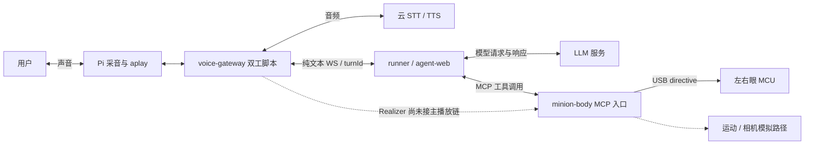
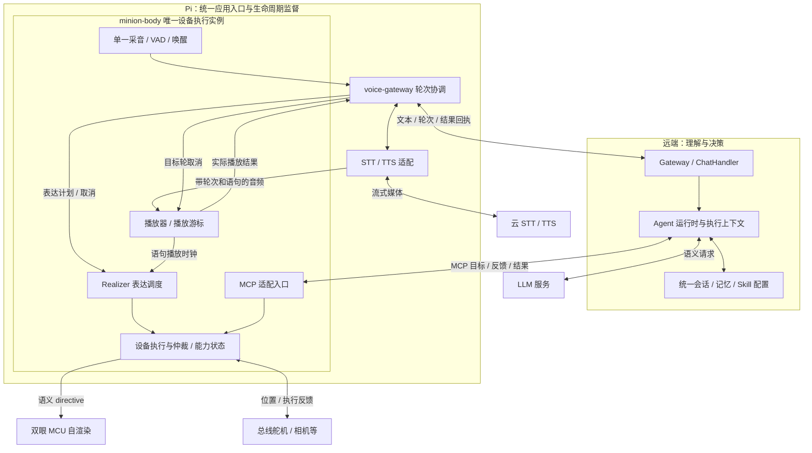
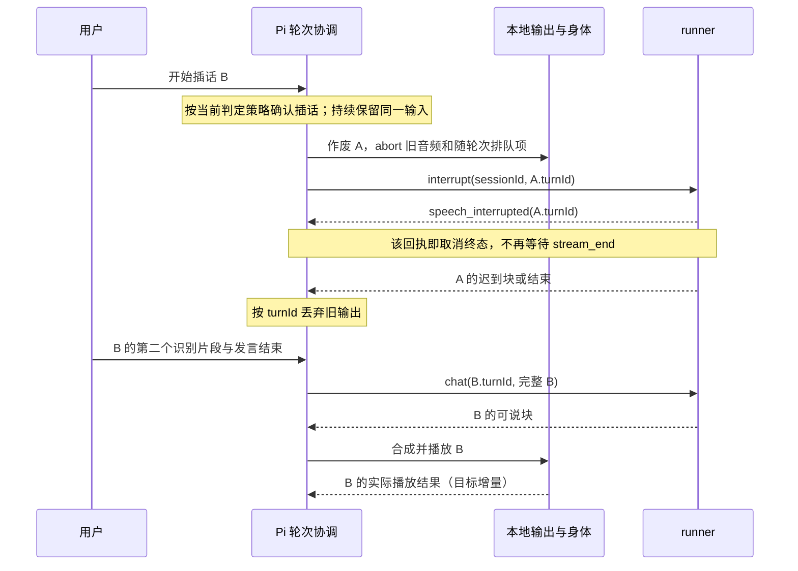
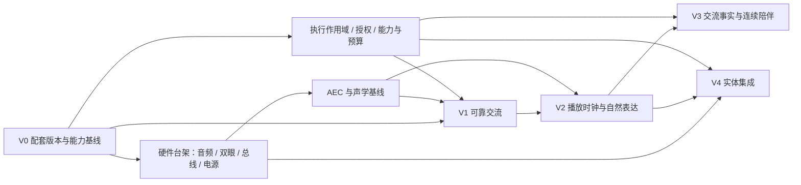

# Runner 与 Minion 系统架构：历史、现状、目标与演进

更新：2026-10-18。范围：runner、voice-gateway、minion-body、minion-eyes，以及“小黄人/files”的产品和实体设计资料。当前实施状态与下一批工作以[实施清单](design/runner-completion-plan.md)为唯一入口；历史 review 和旧验证记录不作为当前待办。

**整体方向：runner 统一智能执行、会话与能力管理，Pi 对现场交互和设备执行负责，眼睛 MCU 持续渲染；以轮次、播放和执行结果连接三者，逐步交付可靠交流、自然表达、连续陪伴和真实身体。**

项目已经从“分别做出大脑、语音和眼睛”进入“共同管理一次完整交流”的阶段。runner 已完成轮次取消、认证会话、统一持久记忆、执行装配、Skill 发布、共享预算和持久任务基础；完整 Pi 播放事实、实机体验和真实运动能力仍需分阶段验收。

全局演进主方案见 [Runner 与 Minion：端到端产品、架构与演进方案](design/runner-minion-system-evolution.md)，按产品设计、架构全景、runner 详细设计、现场交互、数据协议与实施工作包展开。本文保留历史路线、四仓现状证据和 Minion 场景分析；其中设备交付阶段服务于局部验收，全局实施优先级以主方案为准。[runner 内部架构](architecture.md)维护 Java 模块和依赖规则。历史发现保留在[联合 review](reviews/2026-09-06-minion-system-review.md)，当前取消实现以[ADR-015](decisions/015-voice-turn-cancellation.md)为准。本地运行时及状态归属记为[ADR-016 提案](decisions/016-local-interaction-runtime.md)，尚不代表全部实现或部署完成。

阅读路径：[目标](#1-产品目标决定架构边界) → [历史](#2-历史路线及其保留价值) → [现状](#3-当前系统与证据边界) → [目标架构](#4-目标架构三个执行区域六项职责) → [关键链路](#5-用一次交流检验整个架构) → [数据与运行时](#6-让身份政策与事实贯穿执行) → [演进](#7-演进路线按能力交付按依赖推进) → [验收](#8-验收与架构维护)。

2026-09-06 补充：主方案已结合 OpenAI Agent Improvement Loop 与 DeepSeek Harness，增加运行装配、证据评测和版本发布的取舍，见[第 3.1 节](design/runner-minion-system-evolution.md#31-openai-改进循环与-dsh-分别补足什么)。已完成项、未实施项及下次起点集中在[实施进展与续接点](design/runner-minion-system-evolution.md#124-2026-09-06-实施进展与续接点)，新增 [ADR-017](decisions/017-versioned-harness-improvement-loop.md)为 Proposed。

## 1. 产品目标决定架构边界

原始目标是一台个人自用、静态摆桌的陪伴机器人：会对话、有表情、能动、声音好听。后续实体决策收敛为 Ø130 × H240 mm 胶囊形、腰转与双臂、双眼 MCU、独立声腔、骨架与外壳分离。这里采用的是设计约束，实物采购、安装及性能需另有现场记录。[产品目标](../../../小黄人/files/README.md)、[实体决策](../../../小黄人/files/decisions.md)

一个贯穿系统的目标场景是：用户说“今天有点累”，机器人开始回应；用户插话“先别给建议，陪我说两句”，旧声音及时停止，两段输入完整保留，眼睛随新回应变化；次日继续聊，历史与实际播放、执行的事实一致。

| 用户能力 | 系统必须负责的结果 | 主要架构约束 |
| --- | --- | --- |
| 接得住 | 补充条件、多句输入不丢失 | 区分 STT 分段稳定与用户发言结束 |
| 回得自然 | 回应及时、可以改变话题 | 流水线并行；本地掌握取消和播放 |
| 有表现力 | 眼睛与当前话语、状态一致 | 语义表达意图与播放时钟关联 |
| 记得连贯 | 重启可续聊，更正、遗忘和清空有效 | 用户、会话和记录来源统一 |
| 做得可信 | 完成、失败、不可用和未知都准确 | 能力发现、执行授权、设备反馈分层 |

runner 同时是通用 Agent 引擎。因此 Minion 的人格放在 Profile，媒体适配放在 Python，硬件协议放在设备侧；`agent-kernel` 继续维护可复用的执行原语。多 Agent 和其他业务可以复用这套基础，但当前 Minion persona 的 `maxSpawnDepth=0`，产品推进不依赖增加 Agent 数量。[persona 装配](../agent-web/src/main/java/com/lightweightai/web/config/OrchestratorConfig.java)

runner 的产品入口还包括 Web、API 和 SDK，已有 TriggerSource 可以接入主动触发。整体演进包含两条主线：让这些入口消费相同的会话、执行与管理语义；让 Minion 把一次语义请求转成可确认的现场交流。前台对话、后台任务、能力管理是不同使用方式，应复用执行基础，而不各建一套历史、权限和工具链。

| 使用方式 | 现有基础 | 目标体验 |
| --- | --- | --- |
| Web / API / SDK | Gateway、ChatHandler、SDK 与传输适配 | 同一会话的回复、历史、取消和错误语义一致 |
| 现场语音与身体 | 文本 WS、语音客户端、Tool/MCP、设备适配 | 听全、可打断、表达与动作有真实结果 |
| 后台与主动任务 | TriggerSource、SubagentRuntime | 后续按需求补持久任务；可查询、取消和可靠投递 |
| 配置与能力管理 | Profile、Skill 发布、工具与记忆组件 | 配置变化进入真实执行，管理界面展示可核对状态 |

## 2. 历史路线及其保留价值

### 2.1 两条历史逐步汇合

软件路线从通用 Agent 框架出发，实体路线从一台桌面机器人的体验和装配出发。它们在语音、工具和设备接口处相遇，随后暴露出跨仓生命周期问题。

| 阶段 / 依据 | 当时解决的问题 | 留给今天的基础 | 今天需要补上的部分 |
| --- | --- | --- | --- |
| 自定义 Kernel、异步流、Plugin → [ADR-001](decisions/001-reactor-flux-over-custom-stream.md)～[003](decisions/003-agent-loop-over-kernel.md) | 执行路径和扩展方式不统一 | `Flux<StreamEvent>`、`AgentLoop` / `ToolCallingLoop`、Tool | 将统一抽象贯穿装配与实际消费者 |
| 多 Agent → [ADR-004](decisions/004-multi-agent-orchestrator.md) | 路由、工具范围、spawn、打断 | Profile、Registry、Orchestrator、SubagentRuntime | 配置、会话与执行状态进一步隔离 |
| 事件及公共契约 → [ADR-005](decisions/005-streamevent-closed-protocol.md)、CLAUDE.md | 兼容成本与协议演化 | 闭合事件类型、工厂、增量公共 API | 新控制语义明确建模，追踪仅用于观察 |
| 实体化 → [ADR-006](decisions/006-minion-embodiment-architecture.md)及实体决策 | 把文本 Agent 接到声音和身体 | 远端大脑、媒体绕开 JVM、设备侧 Realizer | 明确 Voice Gateway 的实际部署位置与 Pi 的交互职责 |
| 设备链路 → [ADR-007](decisions/007-risk-level-across-mcp.md)～[011](decisions/011-mcp-connection-resilience.md) | 风险信息、远程 MCP、眼睛渲染、视觉回灌、掉线重连 | Tool/MCP 与 directive 分层；图像回到模型；MCU 自渲染 | 真实设备能力、执行回执、配套实机验证 |
| 语音产品化 → [ADR-012](decisions/012-voice-text-plane-contract.md)～[014](decisions/014-brain-swappable-chathandler-openclaw.md) | 文本契约、独立插话、首块输出、大脑替换 | 共享 schema、可说块、取消入口、ChatHandler | 区分接口存在、生产启用和用户体验 |
| 系统收敛 → [review](reviews/2026-09-06-minion-system-review.md)、[ADR-015](decisions/015-voice-turn-cancellation.md) | 旧流不结束、输入重复、迟到消息串轮 | turnId、本地取消、完整输入交接、订阅边界保护 | 播放事实、统一历史、本地执行与持续运行 |

历史上的 R、G、B、Phase 编号主要按仓库或硬件部件拆工；下文 V0～V4 按用户能力拆交付。两者用于不同目的，不能把“某个 G/B 已完成”直接映射为“整机某个版本已完成”。

### 2.2 历史材料里的分歧如何处理

| 早期表述 | 已核对的现状或后续决策 | 当前设计口径 |
| --- | --- | --- |
| Pi 跑完整对话栈 / 瘦身体 | 当前脚本在 Pi 组合采音、STT/TTS 客户端和播放；runner 在远端 | Pi 掌握交互、媒体和设备；远端掌握语义。调用云 API 不等于本地运行语音模型 |
| Voice Gateway 是独立服务 | 当前双工脚本直接导入 minion-body，未形成独立远端媒体服务 | 保留独立模块；近期收敛一个受支持的 Pi 运行入口。进程组合方案见 ADR-016 |
| Pi 直驱眼屏、LVGL 或 sprite | ADR-009 改为双 MCU；当前固件是 Arduino GFX / RoboEye 自绘 | 固件选择服从渲染效果与性能，Pi 只发语义 directive |
| HAT 双麦、PWM 舵机、220 mm 高 | 实体决策更新为 USB 四麦、STS3215 总线、240 mm 高 | 软件适配和 CAD 按后续硬件决策重核；旧尺寸与 PWM 示例保留为历史 |
| 三轨口型是近期主体 | 实体嘴是喇叭格栅，尚无明确嘴形执行器 | 先做好语音与眼睛；viseme 保留扩展位置 |
| MCP producer 仍只有 stdio | 当前 minion-body 已有 streamable-http 和可配置 bearer 包装 | transport 实现已有；Pi/overlay 可达性、鉴权配置与恢复仍需部署验收 |
| 打断后等待 stream_end；STT 只拿第一段 | ADR-015 工作区已改为打断终态、多 final 聚合、旧轮过滤 | 这些是已修增量，不再作为当前未解决问题反复列出 |

工程约束以 [CLAUDE.md](../CLAUDE.md)为准；已接受 ADR 约束其覆盖的设计，提案描述待落实方向；运行现状以入口代码、配置及带版本的测试证据为准。历史 ADR 的 Context 和旧完成清单不承担今日部署盘点职责。

## 3. 当前系统与证据边界

### 3.1 当前工作区的部署视图

下图还原入口与适配路径，不宣称图中所有硬件均已安装。云端在这里表示远端服务，也可以是局域网服务器。



仓库边界是代码维护边界；进程边界是运行和故障隔离边界；设备所有权是资源控制边界。当前同属 Pi 的语音脚本与 MCP 入口尚未自动构成一个共享设备实例，目标架构需要把这个关系显式装配。

### 3.2 能力现状

| 能力 | 当前实现 | 证据与剩余差距 |
| --- | --- | --- |
| Agent / Tool 主链 | Gateway → Orchestrator → AgentLoop → ToolCallingLoop → Provider / ToolExecutor | native 主链已贯通服务器主体、会话记忆、设备上下文、实际参数授权、执行快照和共享预算；真实设备身份及 OpenClaw workspace 仍未统一。见 [AgentLoop](../agent-kernel/src/main/java/com/lightweightai/kernel/agent/AgentLoop.java) |
| 轮次与取消 | Spring WS 可选 turnId；本地取消；旧轮隔离；完整 B 输入；取消覆盖订阅前事件 | [ADR-015](decisions/015-voice-turn-cancellation.md)及 Java/Python 真 WS 往返通过；Pi 声学体验未验收 |
| 输入与插话检测 | 单采集源扇出、边采边转、final 聚合；当前脚本依据云 STT 出字触发插话 | 本地取消执行已解耦网络确认；插话判定仍依赖 STT，不能称为全本地检测。见 [入口](../../voice-gateway/scripts/gateway_voice_duplex.py)、[capture](../../voice-gateway/src/voice_gateway/capture.py) |
| 语音输出 | 云 TTS 流式适配、AplayPlayer、正常 drain / 取消 abort | 主入口首声统计是 write 前的时间；缺真实播放游标。见 [player](../../voice-gateway/src/voice_gateway/player.py) |
| 表达同步 | speakable_chunk 支持 emotion；身体仓已有 Realizer | 缺省 classifier 为 neutral；主入口未接 Realizer，persona 仍先调 set_eyes。见 [装配](../agent-web/src/main/java/com/lightweightai/web/config/PostProcessorConfig.java)、[Realizer](../../minion-body/src/minion_body/realize.py) |
| 设备与视觉 | MCP、风险映射、图像回灌、眼睛串口适配 | 真实舵机和相机仍可走 LoudFakeDevice；模拟成功未收敛成能力状态。见 [device](../../minion-body/src/minion_body/device.py) |
| 眼睛固件 | EMOTION、BLINK、IDLE 与自治渲染 | LOOK 分支仍回 OK 而不执行；本次未构建或刷写。见 [固件入口](../../minion-eyes/src/main.cpp) |
| 会话和记忆 | 认证 native 会话与旧 `/gateway` 入口使用主体分区的 SQLite 历史、摘要、检索和长期记忆工具 | 重启、清空和同名 session 隔离已验收；旧未归属数据不自动迁移，生成文本尚未融合实际播放事实。见 [FileMemoryAdapter](../agent-web/src/main/java/com/lightweightai/web/config/FileMemoryAdapter.java)、[ADR-025](decisions/025-authenticated-session-memory.md) |
| Skill、预算和权限 | Skill 持久发布进入 native prompt；实际参数授权、父子权限、Provider usage、共享根预算和结构化停止已接通 | 受控 HTTP/SSE/WS 与全量 Java 回归通过；真实付费模型账单、设备授权服务及 Pi 现场仍需外部验证。见 [ADR-024](decisions/024-content-bound-skill-publication.md)、[ADR-026](decisions/026-execution-usage-budget-compaction.md) |
| 模型热切换 | 一轮及同源子任务固定 Provider，新执行采用新配置；模型预设元数据持久化且密钥不落盘 | 真实 Spring/MVC 与 HTTP/SSE 往返及重启恢复通过；部署级密钥、外部服务版本和完整发布清单仍需独立管理。见 [ADR-022](decisions/022-execution-model-binding.md)、[ADR-031](decisions/031-persistent-model-config.md) |
| 持久任务与反馈 | 文件任务存储、检查点、有界 runner、主体隔离 API、持久投递队列及反馈索引/API | 未知运行重启后进入 `RECOVERY_REQUIRED`；真实外部副作用核对、生产触发器、部署侧 consumer 和通用线上 trace 摄取仍待接入。见 [ADR-029](decisions/029-durable-task-checkpoints.md)、[ADR-030](decisions/030-feedback-index.md) |
| 可替换大脑 | agent-openclaw 实现 ChatHandler 与协议适配 | 假远端往返已有；真实鉴权、长期连接与历史管理仍待验证。见 [模块状态](modules/agent-openclaw.md) |

### 3.3 当前证据是什么版本

| 仓库 | 核对时 HEAD | 工作区 | 当前可引用证据 |
| --- | --- | --- | --- |
| runner | `2c3b9f1` | 文档收口前代码已提交 | 2026-10-18 全量 `mvn clean test`：2380 项，2358 通过、22 跳过、0 失败/错误；13 模块成功。默认环境未启用可选跨仓 Python voice-gateway 探针；实机与付费服务不在本次证据范围内 |
| voice-gateway | `4f084a7` | 有较多未提交增量 | 本次 Python 3.14 unittest：144 项，136 通过、8 跳过 |
| minion-body | `370942c` | 有未提交增量 | 本次 Python 3.14 unittest：120 项，115 通过、5 跳过 |
| minion-eyes | `50d1340` | 有未提交固件增量 | 本次静态核对；未发现 pio 命令，未构建、刷写或现场检查 |

Python 历史跳过项包括可选 jsonschema、语音 SDK 或设备依赖；voice-gateway 运行还出现未关闭事件循环的 ResourceWarning，需在持续运行验收中追踪。schema 两仓副本的历史比对一致。四仓尚未形成一次正式配套发布，其他仓库的历史 HEAD 不能代表当前已部署组合。

## 4. 目标架构：三个执行区域，六项职责

### 4.1 系统目标图

下图是目标责任关系。播放回执、统一会话服务和设备执行实例的收敛仍需实施；现有 turnId 及取消能力作为起点。



近期目标是一个远端 runner 部署、一个受监督的 Pi 应用入口、两份眼睛固件实例。Pi 应用组合 Python 模块，MCP server 作为同一设备实例的入口；若驱动需要独立进程隔离，则通过本地 IPC 访问唯一所有者。是否拆进程不改变谁掌握设备。

### 4.2 职责与状态归属

| 职责 | 主要落点 | 有权决定的事 | 向其他层提供的结果 |
| --- | --- | --- | --- |
| 语义理解与内容生成 | runner / 当前选定 ChatHandler | 人格、回复、工具目标、推理策略 | 可说文本、表达意图、执行请求 |
| 会话、记忆与配置 | runner 的会话边界 | 用户作用域、可检索事实、Skill / Profile 版本 | 下一轮 prompt、历史、查询与清空结果 |
| 轮次协调 | voice-gateway | 用户发言何时完整、何时作废 A、何时提交 B | 完整输入、取消、跟进状态 |
| 媒体处理 | voice-gateway + body 音频接口 | 语音服务适配、音频格式、合成生命周期 | 带轮次和语句归属的音频 |
| 现场执行 | minion-body | 播放、动作仲裁、能力可用性、设备限位和停止 | 播放回执、完成/失败/未知、设备状态 |
| 连续表现 | minion-eyes | 帧级渲染、眨眼、过渡、离线自治 | 指令处理状态和固件能力 |

“唯一所有者”约束的是会发生竞争的状态：麦克风采集、播放队列、串口、舵机执行。MCP 工具与 Realizer 都经身体实例协调；Pi 发模式和语义，MCU 保持动画细节。下一轮输入可以与上一轮生成、播放并行，取消只作废目标轮的输出。

### 4.3 runner 内部继续保持向下依赖

`agent-kernel` 定义执行、工具、事件与网关原语；`agent-tools`、`agent-mcp`、`agent-openclaw`、`kernel-memory`、`agent-sdk` 等沿既有方向依赖它；`agent-web` 负责 Spring 装配和传输。Soul 业务模块保留在领域层，其存在不要求 Minion 走旧业务执行栈。

| 模块 / 责任 | 保留的边界 | 演进落点 |
| --- | --- | --- |
| agent-kernel | 无 Spring 的执行、模型、工具、事件和网关基础 | 统一运行上下文与存储端口；不引入 Pi 驱动或专用人格 |
| agent-tools / agent-mcp | 具体工具、协议适配与外部能力接入 | 目录、局部绑定、执行授权、结果分层；兼容公开 SPI |
| kernel-memory | 存储与检索实现 | 统一权威记录与可重建索引，消费同一用户/会话作用域 |
| agent-openclaw | ChatHandler 外部大脑适配 | 明确能提供的会话管理、取消和工具语义 |
| agent-sdk | 嵌入式开发者入口 | 可选配置和增量结果类型；无需调用方装配 Spring |
| soul-* | 领域用户、策略、评估与业务工具 | 保持领域规则，历史执行入口逐步适配共同语义 |
| agent-web | 唯一 Spring 装配、Web/API 与管理入口 | 配置实际生效、统一会话管理、监督实例生命周期 |

这里的“服务”首先表示职责，无需新增独立部署。新增存储端口由 kernel 定义、适配层实现、web 装配；业务反向依赖与公共契约破坏均不属于迁移手段。

native 运行时的目标链为：

```text
请求身份与设备能力
    → Profile / Skill 配置快照
    → AgentFactory / AgentLoop
    → Prompt + 会话事实 + 检索结果
    → LLM / ToolCallingLoop
    → 按真实参数与设备状态授权
    → ToolExecutor / MCP
    → 执行结果、usage、取消和追踪回到同一运行上下文
```

工具目录可共享，会话专属工具绑定须局部化。发现工具时的可见性过滤与执行时的参数授权分别验证。压缩覆盖每轮工具循环新增的上下文，预算消费来自实际 usage。Minion 的专用策略由装配和 Profile 提供，公共契约保持 additive-only。

这条链需要同时区分三种状态：全局共享的工具/模型目录；每次运行冻结的身份、Profile/Skill 版本和模型配置；执行中变化的取消、预算和设备在线状态。`ScopedToolRegistry.registerLocal()`、执行装配快照、认证会话命名空间和共享根预算已接入 native 链；子 Agent 继承祖先权限、设备上下文、模型/配置快照和预算。剩余边界是经过认证的具体设备身份、OpenClaw workspace 隔离、生产 trace，以及 Pi 对播放和设备状态的现场事实。

### 4.4 四类数据各走适合的通路

| 通路 | 当前基础 | 目标增量 |
| --- | --- | --- |
| 语义 | WS 文本、可说块、Tool/MCP | 设备能力与表达意图明确关联到执行 |
| 媒体 | Pi ↔ 云语音；媒体绕开 JVM | 音频格式、语句标识、播放偏移清晰可见 |
| 控制 | interrupt、取消 token、abort、directive | 取消/关闭不被满媒体队列阻塞；统一设备仲裁 |
| 事实与观测 | StreamEvent trace、对话 JSONL、工具结果 | 播放回执、动作结果、阶段时间和配置版本 |

这些是语义分类，可复用现有连接与进程内通信。未来播放回执是业务事实，需明确事件类型与契约；TRACE 负责诊断，不充当可靠终态。

## 5. 用一次交流检验整个架构

### 5.1 分清四种结束与三个并行状态

| 边界 | 确认者 | 后续含义 |
| --- | --- | --- |
| STT 一个片段稳定 | 语音服务 | 继续累计，用户可能还有补充 |
| 用户本次发言结束 | Pi 轮次协调 | 完整文本可以提交一次 |
| 大脑生成结束 | runner / ChatHandler | 不再产生本轮文本；播放器可能仍有缓存 |
| 音频实际播放结束 | Pi 播放后端 | 才能确认已播放；仍不能推断用户理解 |

输入状态为“待机 → 收集中 → 已提交 / 放弃 / 失败”；生成状态为“运行 → 完成 / 取消 / 失败”；播放状态为“缓冲 → 播放 → 完成 / 取消 / 失败”。界面可以显示“听、想、说”，内部须保留这三组并行状态。

### 5.2 正常交流

采音由唯一源持续提供，VAD 和唤醒控制输入窗口，STT 稳定片段累计到发言边界。Pi 为本次输入分配 turnId，把完整文本交给 runner；runner 在订阅时建立执行，流式输出可说块。TTS 合成和播放与后续文本生成重叠，Realizer 在语句实际开始播放时应用对应表达。生成结束和播放结束分别记录，随后进入跟进或待机。

“及时让用户知道已被听到”的应答音，与实质回答分开计量。当前基于 STT 文本的唤醒/插话判定与未来本地判定是两个实现阶段，测量必须包含各自的检测延迟。

### 5.3 A 被打断，完整 B 接上



若 A 已生成结束但尚在播放，本地仍立即取消 A 的输出；runner 可以只返回带 A.turnId 的取消回执，不需要虚构活跃 runId。取消不会撤销已完成的工具副作用；长期动作要有自己的停止与结果状态。已有 ADR-015 自动化覆盖首声前取消、晚到旧轮、生成后取消以及失败后 B 继续。

### 5.4 从“调用工具成功”到“现场完成”

目标执行链是：模型请求动作 → runner 按真实参数授权 → MCP 传递目标 → body 检查安装/连接/限位 → 接收或拒绝 → 执行和反馈 → 完成、失败、取消或结果未知。

接受请求、写出串口和硬件到位是不同事实。`set_eyes` 和随语句表达共享执行入口；模型显式动作与自动表现需仲裁。LOOK 未实现、眼睛集合为空、相机未安装时应报告不可用，开发模拟模式显式呈现模拟结果。真实舵机上线前验证速度、范围、超时和停止；已有工具风险等级无法替代设备反馈。

## 6. 让身份、政策与事实贯穿执行

### 6.1 身份层次

| 标识 | 语义 | 当前状态 / 目标 |
| --- | --- | --- |
| userId / deviceId | 谁在使用、哪台设备 | 执行与数据作用域需统一传递；目前不能只凭 session 字符串推导 |
| sessionId | 可跨轮保持的对话 | 已有；native 内部还带 agent 命名空间，需要统一解析入口 |
| turnId | 一次输入及其应答 | ADR-015 可选字段已实现；唯一标识本身不等于网络重试去重 |
| runId | 大脑运行容器的标识 | 已有；native 隐式续接可能复用容器，不能当作 turnId 或播放状态 |
| segmentId / sequence | 一轮里的语句或可说块 | 当前 chunk index 为基础；统一音频、表情、回执归属是后续契约 |
| actionId | 可独立结束的动作 | 后续设备执行契约；可关联 turnId，取消策略按动作性质确定 |
| traceId / 配置版本 | 诊断关联与复现 | 复用现有追踪；补跨仓传播及 Profile/Skill/固件版本 |

连接关闭结束传输；会话身份可保留。重新连接后重新核对能力和会话归属，含副作用的旧请求不透明重放。需要重试的结果回执可以按稳定 ID 幂等合并。

### 6.2 会话是事实来源，播放后端是现场证据来源

目标保存三类信息：用户提交了什么；系统生成和计划了什么；实际播放和执行了什么。它们有关联，但不会互相覆盖。取消的语句可标记“未播出 / 部分播出 / 已播出 / 未知”；无字级对齐时不估算精确听到哪个字。

native 的聊天、历史查询、清空和重启恢复使用同一会话服务。长期偏好与检索知识携带来源和用户作用域；Skill 发布产出的版本由下一轮 AgentFactory / Prompt 真实消费。Pi JSONL 保留现场诊断价值；播放结果可通过有界待发送记录和幂等确认回传，会话端保存其权威副本。媒体包不必全量进入持久化。

OpenClaw 模式下，一个会话绑定一个大脑和一套历史归属；适配层承担对外轮次与管理语义。切换大脑前需验证真实鉴权、取消、历史查询/清空、工具和上下文迁移，不仅比较回答质量。

### 6.3 观测必须对应用户经历

首响从“用户末个语音采样”到“实质回答首次实际输出”；本地停播从“确认插话”到“旧音频最后一次输出”，另报“开始说话 → 确认插话”。句级表达以播放开始为基准；write 时间、模型首 token、TTS 首包都是中间节点。

本地时差用同一单调时钟；跨主机用追踪关联，不直接相减未校准的墙钟。失败、超时和无声响应进入成功率统计。需要观察队列时长、任务/线程数量及设备占用，避免仅以进程存活判定稳定。跨服务上下文传播可沿用 [OpenTelemetry 的 trace/span 模型](https://opentelemetry.io/docs/concepts/signals/traces/)，播放位置仍由输出端提供。

当前硬件设计的独立 DAC/功放与脚本使用的 ReSpeaker 输出链不同。必须先验证播放参考如何进入 AEC，再决定最终输出路径。麦克风安装、音量、舵机噪声、风扇和声腔都会影响插话判定，属于系统验收条件。[实体决策](../../../小黄人/files/decisions.md)、[ReSpeaker 官方配置资料](https://wiki.seeedstudio.com/ReSpeaker_Mic_Array_v2.0/)

### 6.4 故障恢复与部署边界

| 故障 | 目标现场行为 | 保留的系统事实 |
| --- | --- | --- |
| STT 没有可信完整结果 | 结束失败输入，重新等待或请求重说 | 未提交的半成品不进入正常用户历史 |
| TTS 失败 | 停止本轮输出；后端仍可用时给本地简短提示 | 生成结果与未播出/部分播出分别记录 |
| runner / 网络断开 | 本地结束等待并停播，恢复可交互状态 | 旧请求不自动重放；未知工具结果待确认 |
| 某只眼睛或执行器断联 | 已验证的语音能力可继续；更新能力状态 | 返回实际执行覆盖范围，不报告整组成功 |
| 动作超时或无法确认 | 按设备支持的停止策略处理 | 区分取消请求、已停止与结果未知 |
| 进程重启 | 释放并重新发现资源，恢复明确的会话与配置 | 无回执的旧输出记未知，不推断已完成 |

MCP 的取消机制本身不保证撤销操作：接收方可能因任务已完成或无法取消而忽略请求。因此物理停止和结果回执属于 body 的契约。[MCP 取消规范，固定参考版本 2025-06-18](https://modelcontextprotocol.io/specification/2025-06-18/basic/utilities/cancellation)

语音客户端主动连接 runner；MCP 方向仍是 runner 客户端连接 Pi server，通过 ADR-008 描述的私有网络/隧道使 Pi 可达。当前 body 在未配置 token 时仍可启动无鉴权 HTTP 服务，不能将“支持 bearer”视为“部署已鉴权”；受支持配置需要显式声明网络边界、身份及开放能力。[当前 MCP 入口](../../minion-body/src/minion_body/mcp_server.py)

协议升级按现有兼容约束推进：先升级支持关联字段的 Spring `/ws/chat`，再启用带 turnId 的 Python 双工客户端；旧无 turnId 请求保留形状，新增播放/动作回执另定能力协商。一次部署记录大脑选择、语音供应商、音频设备、persona、MCP 端点、协议/固件版本，密钥从运行环境注入。录音上传状态应可观察；目前转写后的唤醒门控不等同于本地唤醒后才上传。

### 6.5 对话、子 Agent 与持久任务的边界

一次 turn 描述输入和应答，run 是运行容器，子 Agent 是执行手段；需要跨连接或重启继续的工作，才需要明确的持久 task。当前 TriggerSource 和内存 SubagentRuntime 不能作为任务已可持久恢复的证据。[现有编排与触发入口](architecture.md#proactive-trigger--triggersource-spi)

后续若要支持“整理这些资料，完成后告诉我”，目标是先保存任务目标、作用域、状态和结果投递方式，再驱动既有 Orchestrator。任务可包含多次执行尝试；取消请求与已停止分别记录。恢复先支持明确检查点，已提交但结果未知的外部操作先核对，不能重跑整段推理来假定恢复成功。具体任务模型和存储事务需单独 ADR，不作为当前语音版本的前置改造。

“先别说了”终止当前输出；“整理任务也取消”针对任务本身。后台结果先保存，再由投递策略决定网页通知、下次交互提示或已允许的播报。子 Agent 完成事件不直接抢占当前音频。管理端围绕会话、任务、能力、记忆和设备展示产品状态，runId 等诊断信息按需展开。

## 7. 演进路线：按能力交付，按依赖推进

### 7.1 五个用户版本

| 阶段 | 架构增量与交付物 | 验收门槛 | 当前定位 |
| --- | --- | --- | --- |
| V0 可复现原型 | 四仓/固件/协议组合清单、统一入口说明、硬件与配置基线、真实/模拟能力表 | 新环境能按记录启动；测试和实机证据可以定位到配套版本 | 工作区核对和测试已有，配套发布与现场盘点待完成 |
| V1 可靠交流 | 收尾 ADR-015 的完整 Pi 链路；输入/生成/播放三状态、故障收尾、有界缓存 | 首声前与播放中插话、多段 B、旧 A 晚到、满队列、断网、SDK 失败均不串轮、不遗留等待 | runner 与跨仓 WS 自动化通过；可选 SDK、持续运行及实机验收仍需补齐 |
| V2 自然表达 | 唤醒/插话判定优化、AEC、播放游标、语句表达、Realizer 接主链 | 端到端首响与停播分布合格；眼睛随对应语句；长时运行无积压 | 分句、流式适配、Realizer 组件可复用；时钟和装配尚未闭合 |
| V3 连续陪伴 | 统一会话持久化、播放事实、用户作用域、Skill 配置消费、预算与压缩 | 重启、查询、更正、清空一致；未播出内容不当作已交流；实际请求使用正确版本和预算 | 会话、用户作用域、Skill、预算与压缩已接主链；播放事实和完整遗忘管理待实施 |
| V4 完整实体 | STS3215 腰转/双臂、按需真实视觉、动作反馈、整机装配和声学 | 动作完成/失败/停止可证明；真实图像到模型；走线、间隙、电源、温升与噪声经过实测 | 目标硬件已记录，驱动/安装/整机状态需核验 |

这些是交付门槛，不是相互阻塞的五个瀑布阶段。软件主线依赖轮次→播放→交流事实；硬件验证可以提前并行。会话专属工具隔离、真实参数授权、设备上下文与预算，按所开放的能力优先接通，不能等多用户或运动功能全部上线才处理。



### 7.2 近期实施顺序及仓库责任

| 顺序 | 发起点与具体动作 | 跨仓下游验收 |
| --- | --- | --- |
| 1. 固定可复现组合 | 四仓记录当前补丁、配置、可选依赖、schema 与固件；标清模拟能力 | 同一套配置可启动，知道每项结果来自真件还是受控对端 |
| 2. 关闭 V1 剩余差距 | voice-gateway 以当前双工入口验证 SDK 取消和持续运行；runner 保持已通过的订阅边界测试 | 真 Spring + Python + 语音 SDK 对受控对端，再测 Pi 麦克风/播放；B 文本只提交一次 |
| 3. 收敛本地执行实例 | body 统一音频/眼睛控制，voice 通过接口消费；MCP 与 Realizer 共用实例 | 同一设备不会重复打开；取消可清除目标轮输出，显式动作不被旧表现覆盖 |
| 4. 建立播放事实 | body 提供游标与结束原因；voice 关联语句/音频并上报；runner 增量消费 | 实际语句开始驱动表情；生成结束后仍可停播；部分播放有准确状态 |
| 5. 统一会话与能力治理 | runner 统一身份、历史、Skill、真实参数授权与预算；body 报告设备能力 | 下一轮实际 LLM/工具收到正确上下文；查询/清空生效；不可用设备明确失败 |
| 6. 完成真实身体 | body/eyes 配合硬件台架接总线、相机、固件能力及整机 | 真实运动和视觉有结果证据；性能和声学数据来自配套实机 |

第 3、4 步应采用兼容适配：现有 AplayPlayer、TextBridge、Tool/MCP 和 directive 先保留，新入口接通后逐步撤下重复所有者。每个切换点先用同一场景比较旧/新路径；保留上一配套配置便于回退，避免同时迁移大脑、语音框架和硬件驱动。

### 7.3 什么时候才值得换架构部件

| 候选变化 | 重新评估的条件 | 始终保持的边界 |
| --- | --- | --- |
| 换语音厂商或端到端语音模型 | 中文效果、延迟、工具和取消控制、费用的同场景证据更好 | turnId、完整输入、实际输出与会话事实 |
| 引入 LiveKit / Pipecat | 现有语音运行时维护成本显著增加，候选通过同一套验收 | 一个轮次负责人、一个设备所有者 |
| native → OpenClaw | 真网关鉴权、会话管理、取消、工具及迁移验证通过 | ChatHandler 对外语义与单会话历史归属 |
| 单进程 → 本地多进程 | 具体驱动崩溃、负载或资源隔离有证据 | 唯一设备所有者与可达取消通道 |
| 轻量执行器 → ROS 2 等体系 | 导航、复杂传感器/规划或机器人生态成为明确需求 | 目标、反馈、结果与本地控制 |
| 单设备 → 多设备 / 更多 Agent | 单设备体验稳定，身份/资源隔离先通过 | 用户/设备/会话/执行作用域 |

上述候选是可替换位置，不是当前路线的必需依赖。外部参考支持责任建模：LiveKit 的轮次与打断关联上下文，Pipecat 区分内容和系统帧，ROS 2 Actions 区分目标/反馈/结果，Home Assistant 以阶段事件观察语音链。[LiveKit](https://docs.livekit.io/agents/logic/turns/)、[Pipecat](https://docs.pipecat.ai/api-reference/server/frames/overview)、[ROS 2 Actions](https://design.ros2.org/articles/actions.html)、[Assist pipeline](https://developers.home-assistant.io/docs/voice/pipelines/)

### 7.4 runner 平台主线如何与整机演进配合

| 平台增量 | 对 Minion 的直接价值 | 独立完成条件 |
| --- | --- | --- |
| 运行上下文、局部工具、真实参数授权 | 当前会话调用正确设备，取消和预算贯穿执行 | 多会话交错时，实际工具收到正确身份/参数；子运行不扩大权限 |
| 配置快照、Skill 接线、循环 usage/压缩 | 人格与技能发布生效，长对话资源可控 | 下一次真实模型请求使用正确版本，工具循环增长触发压缩和预算约束 |
| 统一会话与持久化 | 重启续聊、查询清空一致、未播放内容有标记 | Web、SDK 与语音消费同一事实来源，存储恢复和作用域验证通过 |
| 持久任务与受控投递 | 边聊边完成长工作，结果在合适时机呈现 | 固定检查点恢复、重复触发去重、未知副作用处置和取消通过 |
| 多设备 / 多 Agent 扩展 | 共享能力并协调更复杂任务 | 先证明资源隔离、并发预算、权限继承和结果归属，再扩大规模 |

前三项是现有基础的收敛，可随 V1～V3 逐项交付；后两项按明确产品需求立项。每次迭代选择一个跨入口或跨仓场景完成接线，再扩展使用范围，避免只增加平台抽象而没有可体验的结果。

## 8. 验收与架构维护

### 8.1 每个版本保留两种证据

**自动化证据**验证实际载荷、时序与资源收尾：真实框架驱动本方代码，受控对端替代模型、语音服务或设备；先复现失败，再修复。**实机证据**验证声学、显示、机械和实际输出：记录 Pi、模型、网络、音量、距离、固件和配置。同一条功能不得用组件测试结果替代整机结论。

以下数值沿用既有目标方案，是待校准的项目目标，并非实测成绩。先固定 Pi、模型、网络、音量、距离和音频格式，采集至少 100 个有效短对话样本作初步校准；长工具调用另分组，失败也计入请求成功率。

| 验收项 | 测量或断言 | 初始门槛 |
| --- | --- | --- |
| 完整输入和旧轮隔离 | B 的实际下游文本；取消后 A 的晚到块、结束与重复回执 | 确定性场景中不丢片段、不重复提交、不串轮 |
| 实质回答首响 | 用户最后语音采样 → 实质回答首次输出 | 短回复 p50 ≤ 1.3 s、p95 ≤ 2.5 s；应答音单独记录 |
| 本地停播 | 确认插话 → 旧音频最后输出 | p95 ≤ 250 ms；另报语音开始 → 确认插话的分布 |
| 语句与表情 | 语句音频实际开始 → 对应表情生效 | 有播放游标后初步按 p95 ≤ 150 ms 校准，动画完成时间另计 |
| 持续运行 | 队列时长、线程/任务数、设备占用 | 先做 2 小时固定负载观察，再做日常长时使用，无持续增长 |
| 会话与能力一致性 | 重启、查询、清空、Skill、预算及不可用设备 | 场景全部检查实际模型输入、工具结果和下一轮行为 |

若只能采集 write 时间，指标名称必须是写入延迟；播放后端游标还应以回环或录音复核。语音识别准确率与协议传输完整性分别评价。

本次 Python 检查命令分别在 voice-gateway、minion-body 仓执行：

```bash
PYTHONDONTWRITEBYTECODE=1 PYTHONPATH=src python3 -m unittest discover -s tests -v
```

Java 全量命令与 ADR-018—022 最新验证见[实施进展](design/runner-minion-system-evolution.md#124-2026-09-06-实施进展与续接点)；早期轮次场景保留在[ADR-015 验证记录](decisions/015-voice-turn-cancellation.md#runner-verification-recorded-on-2026-09-06)。上述 Python 完整套件结果是先前架构核对时的证据，本轮只重跑 runner 全量和其中的 Python 往返探针。

### 8.2 文档各自承担一件事

| 材料 | 用途与维护规则 |
| --- | --- |
| 全局演进主方案 | 产品、runner 与 Minion 的端到端设计及全局工作包优先级 |
| 本文 | 历史路线、四仓现状证据与 Minion 场景分析；重要增量完成后更新现状 |
| architecture.md / modules | Java 内部设计与各模块职责，链接跨仓边界 |
| decisions | 记录取舍、状态、替代关系；提案与已接受决策分开 |
| contract | 机器可验证的线格式、兼容策略和跨仓验收入口 |
| review | 保留当时发现和复现，追加修复去向，不重写历史 |
| 实体 decisions / 阶段资料 | 硬件设计意图；实物参数和装配验收另行记录 |

接下来最有价值的交付，是在固定配套版本上完整证明：能接住 B、立即作废 A、让声音和眼睛同属 B，并把实际交流与执行结果带到下一次。沿着这条链补齐所有权、时钟和事实，现有四仓就能逐步形成一个可持续演进的系统。
